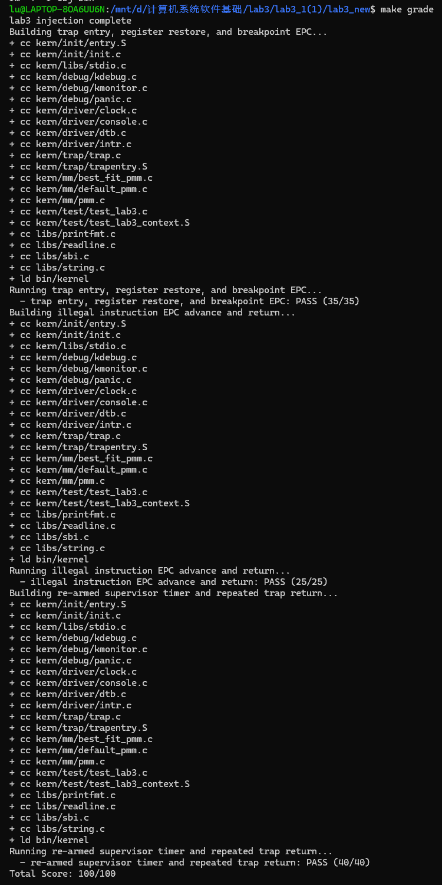

# 实验报告

## 实验基本信息

| 项目 | 内容 |
|------|------|
| **实验名称** | Lab 3：中断处理机制 |
| **小组成员** | 2510720-董隽仪、2512607-董语晗、2513328-何妍希 |
| **完成日期** | 2026-11-05 |

### 小组分工

练习代码分工如下：

| 成员 | 负责的练习或模块 |
|------|----------------|
| 2512607-董语晗 | 功能模块一：`RESTORE_ALL` 和 `__alltraps`，完成 Trap 上下文恢复及汇编入口与 C 函数的衔接 |
| 2513328-何妍希 | 功能模块二：`interrupt_handler()`，完成中断分类、时钟事件重设、计数输出和关机处理 |
| 2510720-董隽仪 | 功能模块二：`exception_handler()` 及指令长度判断，完成非法指令、断点异常和兜底处理 |

实验报告分工如下：

| 成员 | 报告分工 |
|------|----------|
| 2512607-董语晗 | 功能模块一原理、Spec、Prompt 与实现过程整理 |
| 2513328-何妍希 | 中断处理、时钟中断和测试结果整理 |
| 2510720-董隽仪 | 异常处理、知识点总结与报告整合 |

---

## 一、实验目的

本实验的主要目的是：

1. 理解 RISC-V 中 Trap、中断和异常的概念，以及 `stvec`、`sepc`、`scause`、`sstatus`、`stval` 等 CSR 的作用。
2. 掌握 Trap 上下文保存、Trap frame 传递、C 语言分发处理、上下文恢复和 `sret` 返回的完整流程。
3. 实现时钟中断、非法指令异常和断点异常的分类处理，理解 `epc` 更新与持续时钟事件之间的关系。

---

## 二、实验环境

### 2.1 软件与工具链

| 项目 | 版本或配置 |
|------|------------|
| 操作系统环境 | Windows 11 与 WSL Ubuntu |
| QEMU | `qemu-system-riscv64 4.1.1` |
| RISC-V 交叉编译器 | `riscv64-unknown-elf-gcc 14.2.0` |
| GNU Make | 4.4.1 |
| 目标架构 | RV64 |

### 2.2 AI 工具

| 成员 | AI 编程工具 | 底层模型 | 备注 |
|------|------------|---------|------|
| 2512607-董语晗 | Codex Desktop | GPT-6.1 | 辅助分析 Trap frame 布局、汇编入口与恢复流程 |
| 2513328-何妍希 | Codex Desktop | GPT-5.6 | 辅助实现中断分类和持续时钟中断 |
| 2510720-董隽仪 | Codex Desktop | GPT-6.1 | 辅助实现异常分类和指令长度判断 |

---

## 三、实验整体逻辑分析

### 3.1 本章节的逻辑主线

本章围绕“Trap 上下文保存与恢复—Trap 入口与返回—中断与异常处理”展开。Trap 是处理器暂停当前执行流并转入内核处理程序的统一机制。实验目标是让内核不仅能够产生 Trap，还能够完整保存现场、进入 C 处理函数、处理具体原因，并恢复现场返回原执行流。

完整控制流如下：

```text
原执行流
  → Trap 发生
  → __alltraps
  → SAVE_ALL 建立 Trap frame
  → trap(tf)
  → trap_dispatch()
  → interrupt_handler() 或 exception_handler()
  → __trapret
  → RESTORE_ALL
  → sret
  → 原执行流继续运行
```

### 3.2 功能的逐步实现

1. 首先由 `idt_init()` 把 `stvec` 设置为 `__alltraps`，建立统一 Trap 入口。
2. Trap 发生后，硬件更新相关 CSR，`SAVE_ALL` 再把通用寄存器和 CSR 保存到栈上的 `struct trapframe` 中。
3. `__alltraps` 按 RISC-V ABI 将 Trap frame 指针放入 `a0`，调用 `trap(tf)`，从汇编入口进入 C 语言处理层。
4. `trap_dispatch()` 根据 `scause` 最高位区分异步中断和同步异常，再调用对应处理函数。
5. 时钟中断处理函数重新设置下一次时钟事件并更新 `ticks`；异常处理函数输出诊断信息并调整 `epc`。
6. 最后由 `RESTORE_ALL` 按保存时的布局恢复 CSR 和通用寄存器，执行 `sret` 返回，形成完整闭环。

---

## 四、实验内容与实现

### 功能模块一：Trap 上下文恢复与 Trap 入口

**负责人：** 2512607-董语晗

#### 模块功能描述

**需要实现或修改的接口：**

```asm
.macro RESTORE_ALL
.endm

.globl __alltraps
__alltraps:
```

**功能说明：**

`SAVE_ALL` 在栈上分配 `36 * REGBYTES` 字节，依次保存 32 个通用寄存器以及 `sstatus`、`sepc`、`stval` 和 `scause`。`RESTORE_ALL` 必须使用完全相同的偏移恢复现场。

`x2` 即 `sp` 的处理不同于普通寄存器：Trap 入口先把原 `sp` 写入 `sscratch`，调整栈后再把原值保存到 Trap frame 的 x2 槽位。因此恢复时必须最后加载原 `sp`；如果提前恢复，后续加载就会失去 Trap frame 的基地址。

`__alltraps` 执行 `SAVE_ALL` 后，当前 `sp` 就是 `struct trapframe *`。代码通过 `mv a0, sp` 传递第一个参数，再调用 `trap()`。处理函数返回后顺序进入 `__trapret`，完成恢复并执行 `sret`。

#### 提示词

````markdown
# [PROMPT]

**任务**:现在我正在完成操作系统实验，需要实现 Trap 上下文恢复与 Trap 入口功能。请根据我提供的实验框架代码，帮助我完成 `kern/trap/trapentry.S` 中两个待实现部分：

- `RESTORE_ALL`
- `__alltraps`

**操作要求**：你必须在项目中修改文件，保留现有代码，只在标记位置补全。

**输出要求**：直接进行文件操作，使用下面部分的信息。完成后，请提供给我你进行了修改的文件的清单。

# [RELY]

阅读 `trapentry.S`、`trap.h`，分析：

- `SAVE_ALL` 的具体实现。
- `struct trapframe` 的字段顺序及偏移量。
- `__trapret` 的已有实现。
- `RESTORE_ALL` 应当恢复哪些内容。
- `__alltraps` 如何将 Trap frame 传递给 C 函数。

在此基础上实现'RESTORE_ALL'和'_alltraps'两个部分的功能

# [GUARANTEE]

本任务的目标是实现 RISC-V Trap 处理过程中的底层上下文管理，使系统能够完成以下完整流程：

Trap 发生 → 保存处理器上下文 → 进入 C 语言 Trap 处理函数 → 恢复处理器上下文 → 通过 `sret` 返回原执行流。

其中，已有的 `SAVE_ALL` 负责保存 Trap 发生时的处理器状态，本次只允许实现 `RESTORE_ALL` 和 `__alltraps`，不得修改已有的 `SAVE_ALL`、`struct trapframe`、`trap()` 函数签名及其他无关代码。

1. 必须以我提供的实际代码为依据，不得直接套用其他操作系统或实验版本的代码。
2. 不得修改 `SAVE_ALL`。
3. 不得修改 `struct trapframe`。
4. 不得修改 `trap(struct trapframe *tf)` 的函数签名。
5. 不得修改实验框架中其他已经实现的函数或宏。
6. 不得自行假设寄存器偏移量、Trap frame 大小或 CSR 布局。
7. 不得遗漏任何由 `SAVE_ALL` 保存、且需要由 `RESTORE_ALL` 恢复的状态。
8. 代码必须符合 RISC-V 64 位汇编语法及实验框架的编译环境。

# [SPECIFICATION]

## 1. 实现 RESTORE_ALL

请首先仔细分析已有的 `SAVE_ALL` 宏，明确以下内容：

- 每个通用寄存器保存到 Trap frame 中的偏移量。
- `sstatus`、`sepc`、`scause`、`stval` 等 CSR 的保存方式。
- Trap frame 的总布局和栈指针的变化。
- `x2(sp)` 与其他通用寄存器的保存方式是否存在区别。

在此基础上实现 `RESTORE_ALL`，要求：

1. 从当前栈指针所指向的 Trap frame 中恢复所有已保存的通用寄存器。
2. 正确恢复必要的 CSR 状态，特别是 `sstatus` 和 `sepc`。
3. 严格按照 `SAVE_ALL` 的实际保存偏移进行恢复，不能自行假设 Trap frame 布局。
4. 特别处理原始 `sp` 的恢复，避免在恢复过程中因修改当前栈指针而导致后续寄存器读取错误。
5. 恢复完成后，使处理器能够通过后续的 `sret` 正确返回 Trap 发生前的执行位置和特权状态。

## 2. 实现 __alltraps

请分析当前汇编文件中 `SAVE_ALL`、`RESTORE_ALL`、`__alltraps` 和 `__trapret` 的关系，以及 C 语言函数的调用约定。

实现 `__alltraps`，要求：

1. 在 Trap 入口执行已有的 `SAVE_ALL`，建立完整的 Trap frame。
2. 正确获取当前 Trap frame 的起始地址。
3. 按照 RISC-V 函数调用约定，将 Trap frame 地址放入正确的参数寄存器 `a0`，作为 `trap(struct trapframe *tf)` 的第一个参数。
4. 正确调用 C 语言函数 `trap()`。
5. `trap()` 返回以后，进入已有的 `__trapret`，由其完成上下文恢复和 Trap 返回。
6. 不得破坏 Trap frame 中保存的上下文信息。
7. 不得擅自修改 `__trapret` 的已有实现。

## 3.正确性验证

请逐项检查：

- Trap frame 中的寄存器是否全部正确恢复。
- 原始 `sp` 是否正确恢复。
- `sstatus` 和 `sepc` 是否正确恢复。
- `__alltraps` 是否正确调用 `trap()`。
- C 函数返回后是否能够进入 `__trapret`。
- 是否存在破坏 Trap frame 或提前覆盖寄存器的问题。

````

#### 实现迭代过程

本模块经历了两次实现与集成检查。

##### 第一次迭代

根据 `SAVE_ALL` 的槽位生成了寄存器恢复和 C 函数调用代码，Trap frame 布局、`sp` 最后恢复以及 `a0` 参数传递均符合要求。但使用 GCC 14.2 编译时出现：

```text
Error: unknown CSR `sbadaddr'
```

问题不是 `RESTORE_ALL` 的偏移，而是原代码使用了旧 CSR 名称。当前工具链要求使用标准名称 `stval`。

##### 第二次迭代

将读取 Trap value 的指令由 `csrr s3, sbadaddr` 修改为 `csrr s3, stval`。该修改只解决工具链兼容问题，不改变 Trap frame 布局。重新运行测试后，Trap 入口、寄存器恢复和断点返回测试通过，得分 `35/35`。

**关键改进点总结：**

1. 在 `[RELY]` 中明确 36 个寄存器槽位，避免恢复偏移错误。
2. 在 `[SPECIFICATION]` 中明确 `sp` 必须最后恢复。
3. 根据当前 RISC-V 工具链把旧 CSR 别名替换为标准名称。

---

### 功能模块二：中断与异常处理

功能模块二由两个能够独立实现和验证的任务组成：中断处理负责异步 Trap，异常处理负责同步 Trap。两个任务共用 `struct trapframe` 和统一的 `trap_dispatch()`，但输入 cause 的类别、状态变化和验收场景不同，因此分别编写 Prompt，并由两位成员独立负责。

#### 任务一：中断处理

**负责人：** 2513328-何妍希

**需要实现或修改的函数：**

```c
void interrupt_handler(struct trapframe *tf);
```

**功能说明：**

`interrupt_handler()` 去除 `scause` 最高中断标志位后，区分软件中断、时钟中断和外部中断。对于 `IRQ_S_TIMER`，每次处理都重新安排下一次时钟事件并递增 `ticks`；每达到 `TICK_NUM` 的整数倍输出统计，累计输出达到 `SHUTDOWN_AFTER` 次后调用 `sbi_shutdown()`。未知中断输出实际 cause 和完整 Trap frame。

##### 提示词

````markdown
[PROMPT]
**任务**：修改文件 `kern/trap/trap.c`，实现 `interrupt_handler(struct trapframe *tf)`，使内核能够分类处理中断，并持续处理 S 模式时钟中断。

**操作要求**：必须修改项目中的实际文件，保留现有代码和 `lab3` 注释。不得修改 `exception_handler()`、`trap_dispatch()`、`trap()`、`struct trapframe` 或其他公开接口。

**输出要求**：直接进行文件操作，使用下面 `[RELY]`、`[GUARANTEE]` 和 `[SPECIFICATION]` 中的信息，以真实工程代码为准，不引入与中断处理无关的功能。

[RELY]
#define TICK_NUM 100
#define SHUTDOWN_AFTER 10

// libs/riscv.h 提供 IRQ_U_SOFT 到 IRQ_M_EXT 的中断编号
#define IRQ_U_SOFT   0
#define IRQ_S_SOFT   1
#define IRQ_H_SOFT   2
#define IRQ_M_SOFT   3
#define IRQ_U_TIMER  4
#define IRQ_S_TIMER  5
#define IRQ_H_TIMER  6
#define IRQ_M_TIMER  7
#define IRQ_U_EXT    8
#define IRQ_S_EXT    9
#define IRQ_H_EXT    10
#define IRQ_M_EXT    11

struct trapframe {
    struct pushregs gpr;
    uintptr_t status;
    uintptr_t epc;
    uintptr_t badvaddr;
    uintptr_t cause;
};

extern volatile size_t ticks;
void clock_set_next_event(void);
void print_trapframe(struct trapframe *tf);
void sbi_shutdown(void);
static void print_ticks(void);

// RV64 的 scause 最高位为 1 表示中断，其余位为中断编号

[GUARANTEE]
必须实现：
```c
void interrupt_handler(struct trapframe *tf);
```

可以增加仅用于统计输出次数的函数内部静态变量，不得修改公开接口和统一 Trap 分发流程。

[SPECIFICATION]
## interrupt_handler
**Pre-Condition**:
- `tf` 指向有效 Trap frame，`tf->cause` 保存当前中断原因。
- 时钟和 SBI 接口已经初始化并可调用。

**Post-Condition**:
- 当前中断已按去除最高标志位后的实际编号分类处理。
- 可识别中断已输出对应提示；未知中断已输出 cause 和完整 Trap frame。
- 除达到关机条件外，函数能够返回统一 Trap 恢复流程。

**Case 1：S 模式时钟中断**:
- 安排下一次时钟事件，使 `ticks` 恰好增加一次；新值为 `TICK_NUM` 的整数倍时输出一次统计，累计输出达到 `SHUTDOWN_AFTER` 次时调用关机接口。

**Case 2：其他已知中断**:
- 输出与中断类型对应的提示，不修改 `ticks` 和 `epc`。

**Case 3：未知中断**:
- 输出 `Unknown interrupt: cause N`，其中 `N` 是实际中断编号，并调用 `print_trapframe(tf)`。

**Requirements**:
- 分类前必须排除 `scause` 最高中断标志位的影响。
- 每次 S 模式时钟中断都必须重新安排下一次事件。
- 每次时钟中断只能使 `ticks` 增加一次。
````

##### 实现迭代过程

第一次设计只说明“识别并处理时钟中断”，没有明确 SBI 定时器是一次性事件，存在只收到一次中断的风险。完善 Prompt 后，在 `[SPECIFICATION]` 中加入“每次 `IRQ_S_TIMER` 都重新安排下一事件”的 Requirements，并将已知中断、时钟中断和未知中断拆成三个 Case。

最终中断测试能够持续运行到 200 ticks，`100 ticks` 和 `ticks=200` 均正常输出，评分为 `40/40`。

---

#### 任务二：异常处理

**负责人：** 2510720-董隽仪

**需要实现或修改的函数：**

```c
void exception_handler(struct trapframe *tf);
```

允许增加模块内部辅助函数：

```c
static size_t trapped_instruction_length(uintptr_t epc);
```

**功能说明：**

`exception_handler()` 处理非法指令和断点异常，输出异常类型和地址，并更新 `tf->epc`，防止返回后再次执行同一条异常指令。RISC-V 同时支持 16 位压缩指令和 32 位普通指令，因此通过指令低两位判断长度：低两位为 `11` 时长度为 4 字节，否则为 2 字节。其他异常调用 `print_trapframe(tf)` 兜底输出。

##### 提示词

````markdown
[PROMPT]
**任务**：修改文件 `kern/trap/trap.c`，实现 `exception_handler(struct trapframe *tf)` 及必要的指令长度判断辅助函数，使内核能够处理非法指令和断点异常，并从正确的下一条指令继续执行。

**操作要求**：必须修改项目中的实际文件，保留现有代码和 `lab3` 注释。不得修改 `interrupt_handler()`、`trap_dispatch()`、`trap()`、`struct trapframe` 或其他公开接口。

**输出要求**：直接进行文件操作，使用下面 `[RELY]`、`[GUARANTEE]` 和 `[SPECIFICATION]` 中的信息，以真实工程代码为准，不引入与异常处理无关的功能。

[RELY]
#define CAUSE_ILLEGAL_INSTRUCTION 0x2
#define CAUSE_BREAKPOINT          0x3

struct trapframe {
    struct pushregs gpr;
    uintptr_t status;
    uintptr_t epc;
    uintptr_t badvaddr;
    uintptr_t cause;
};

void print_trapframe(struct trapframe *tf);

// tf->cause 保存同步异常编号，tf->epc 指向触发异常的指令
// RISC-V 指令低两位为 11 时是 32 位指令，否则是 16 位压缩指令

[GUARANTEE]
必须实现：
```c
void exception_handler(struct trapframe *tf);
```

可以根据需要添加：
- 指令长度判断辅助函数，必须声明为 `static`；
- 仅在 `trap.c` 内使用的内部常量。

不得修改公开接口和统一 Trap 分发流程。

[SPECIFICATION]
## exception_handler
**Pre-Condition**:
- `tf` 指向有效 Trap frame。
- `tf->cause` 保存同步异常编号，`tf->epc` 指向触发异常的指令。

**Post-Condition**:
- 非法指令和断点异常已输出对应诊断信息，并把返回地址更新到下一条指令。
- 未规定专门处理方式的异常已输出完整 Trap frame。

**Case 1：非法指令异常**:
- 当 cause 为 `CAUSE_ILLEGAL_INSTRUCTION` 时，输出包含 `Illegal instruction at` 和异常地址的信息；根据实际指令长度把 `tf->epc` 增加 2 或 4。

**Case 2：断点异常**:
- 当 cause 为 `CAUSE_BREAKPOINT` 时，输出包含 `Breakpoint at` 和异常地址的信息；根据实际断点指令长度更新 `tf->epc`。

**Case 3：其他异常**:
- 不假设该异常能够恢复，只调用 `print_trapframe(tf)` 输出诊断信息。

**Requirements**:
- 不能固定假设所有异常指令长度相同。
- 判断指令长度时遵循 RISC-V 指令低两位编码规则。
- 不修改无关 Trap frame 字段和全局状态。
````

##### 实现迭代过程

第一版设计倾向于为非法指令固定执行 `epc += 4`、为断点固定执行 `epc += 2`，只能覆盖测试中的典型编码。检查 RISC-V 压缩指令规则后，在 `[RELY]` 和 Requirements 中明确指令长度判断规则，并增加模块内部辅助函数动态返回 2 或 4。

最终非法指令可以输出规定信息、跳过触发异常的指令并正常返回；断点 EPC 和其他异常的 Trap frame 兜底行为也通过测试，评分为 `25/25`。

---

## 五、测试与验证

执行以下命令进行完整测试：

```bash
make clean
make grade
```

测试结果如下：

| 测试项目 | 结果 | 得分 |
|----------|------|-----:|
| Trap 入口、寄存器恢复与断点 EPC | PASS | 35/35 |
| 非法指令 EPC 前进与返回 | PASS | 25/25 |
| S 模式时钟中断重设与重复返回 | PASS | 40/40 |
| **总分** | **PASS** | **100/100** |

**测试截图：**



---

## 六、实验总结与收获

### 6.1 对操作系统的理解

#### 本实验中的重要知识点

1. **Trap、中断与异常**：Trap 是控制流进入内核处理程序的统一机制。中断通常来自设备或定时器，是异步事件；异常由当前指令触发，是同步事件。实验把这一抽象落实为 `scause` 编码、`stvec` 入口和统一分发流程。
2. **上下文保存与恢复**：Trap frame 保存寄存器、返回地址和处理器状态，是中断处理、系统调用和进程切换的基础。本实验只恢复同一执行流，还没有切换到另一个进程，因此是完整进程上下文切换的基础部分。
3. **特权级与 CSR**：`stvec` 指定入口，`sepc` 保存返回位置，`scause` 保存原因，`sstatus` 保存状态，`stval` 保存异常附加信息。它们是 RISC-V 提供给操作系统的特权接口。
4. **汇编与 C 的 ABI**：`__alltraps` 使用 `a0` 传递 Trap frame 指针，说明手写汇编和编译器生成的 C 代码必须遵守同一调用约定。
5. **时钟中断**：持续时钟中断是时间统计和抢占式调度的基础。本实验只进行事件重设、计数和关机，尚未真正触发调度。
6. **异常恢复与指令长度**：更新 `epc` 必须考虑 RISC-V 压缩指令，体现了 OS 异常处理与具体 ISA 规则之间的联系。
7. **中断开关与原子性**：单处理器中可以通过 `sstatus.SIE` 控制中断以保护短临界区，但多核环境仍需要锁等同步机制。

#### OS 原理中重要但本实验未覆盖的知识点

1. 完整的进程控制块、就绪队列、调度算法和进程上下文切换。
2. 用户态通过 `ecall` 进入内核的系统调用分发、参数检查和返回流程。
3. PLIC 外部中断控制器的配置、优先级、认领和完成机制。
4. 中断嵌套、内核抢占以及嵌套 Trap 对内核栈的影响。
5. 多核环境中的核间中断、内存屏障和并发同步。
6. 缺页异常的页面分配、数据装入和非法访问终止机制。
7. 设备驱动中上半部与下半部的拆分，以及用户态信号传递。

### 6.2 AI 协作开发的经验

本实验表明，AI 能否生成可用的操作系统代码，主要取决于需求是否准确。只描述“实现中断处理”会遗漏时序、状态和边界条件；按照 `[PROMPT]`、`[RELY]`、`[GUARANTEE]`、`[SPECIFICATION]` 组织需求后，AI 可以明确知道允许修改的文件、真实接口、各执行分支及系统不变量。

`[RELY]` 必须来自工程真实代码。例如宏名、Trap frame 布局和 CSR 名称只要有一处不一致，就可能导致编译失败或上下文错位。`[SPECIFICATION]` 应描述行为而不是直接规定每条实现语句，同时必须覆盖时钟重设、未知 cause、压缩指令长度等关键 Case。

AI 生成代码以后仍需要人工审查和测试。我们通过编译日志定位 `sbadaddr` 的工具链兼容问题，再利用 `make grade` 区分上下文、异常和时钟三个功能，最终得到 `100/100`。这一过程说明 AI 更适合作为实现和分析助手，最终正确性仍应由代码审查、体系结构规范和可重复测试共同保证。
