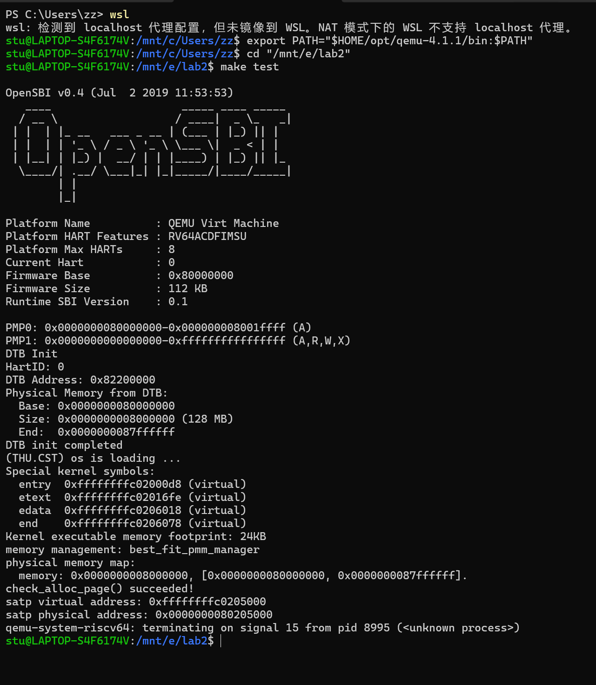
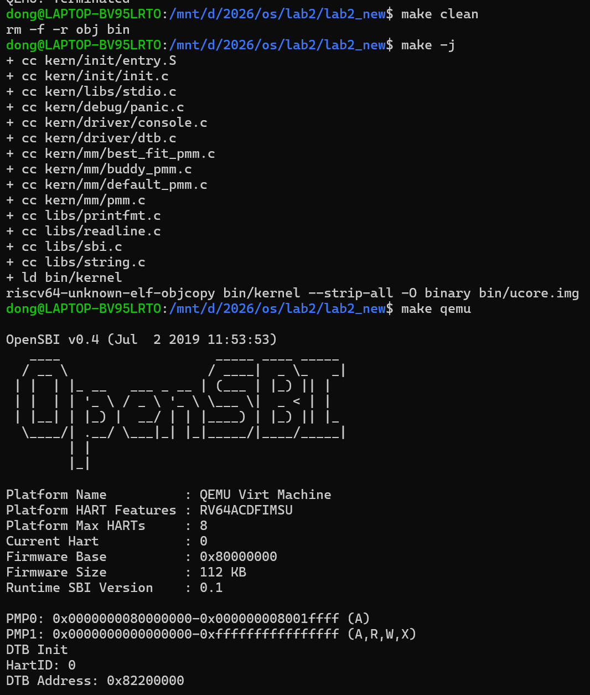
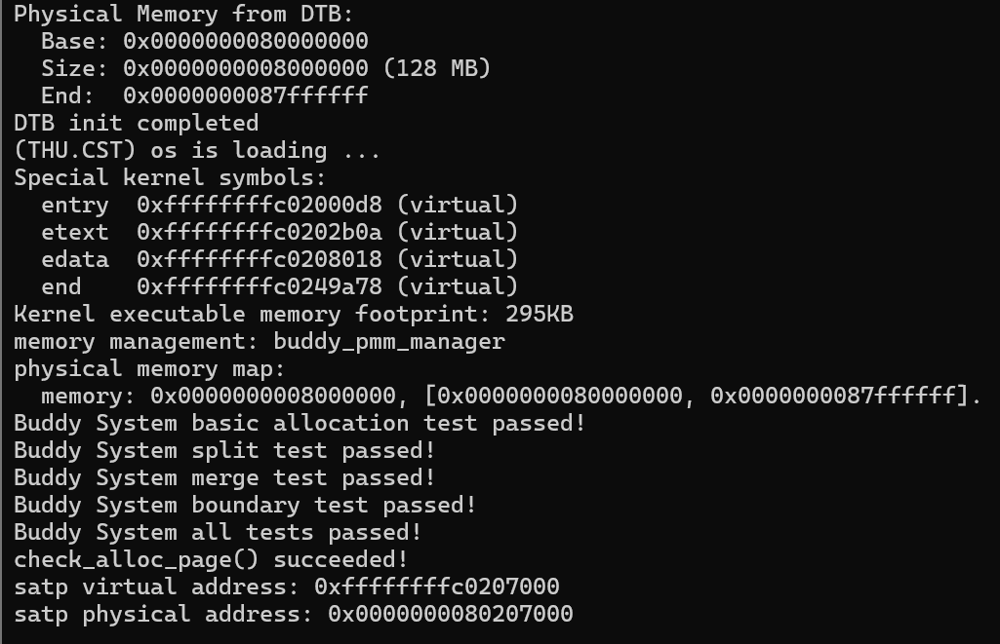
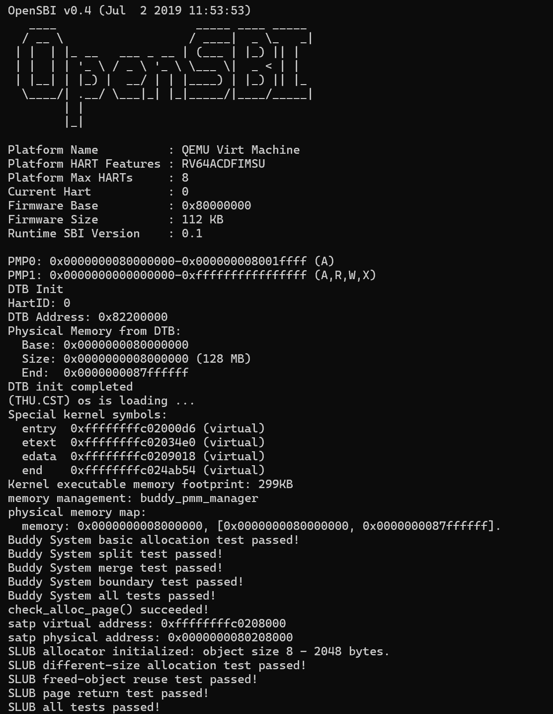
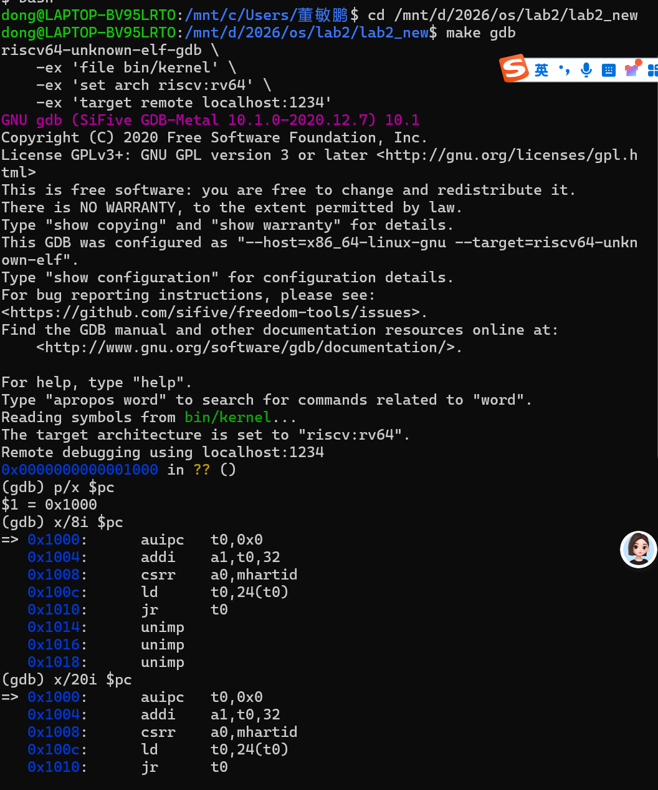
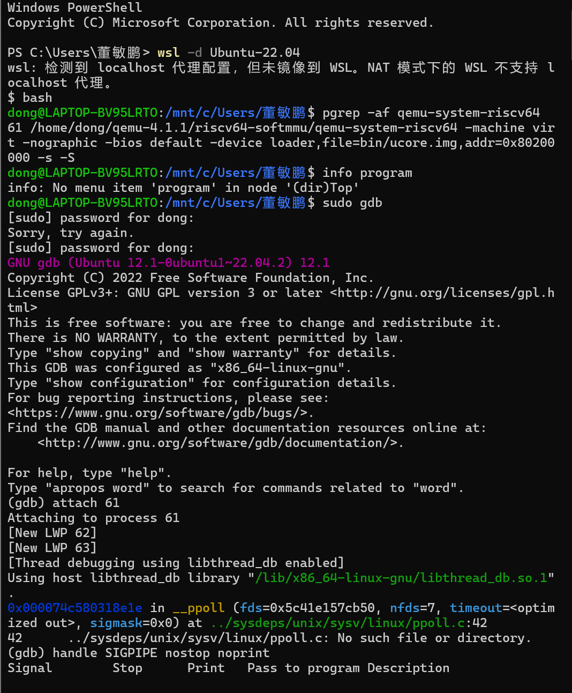
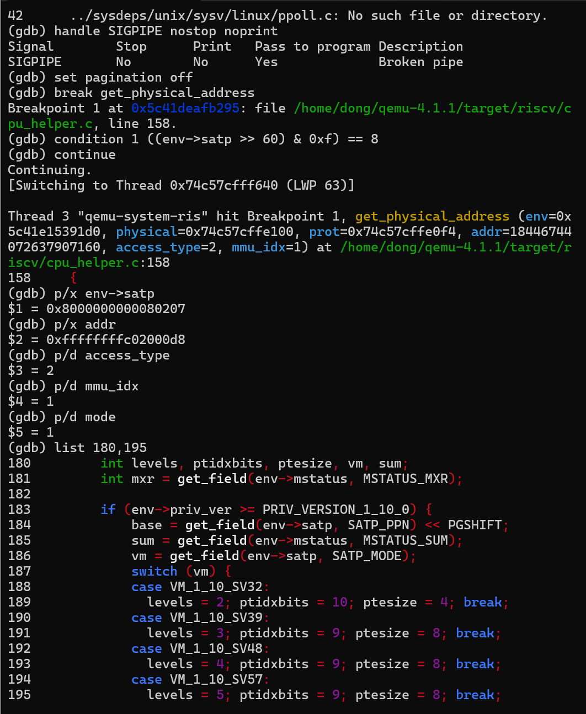
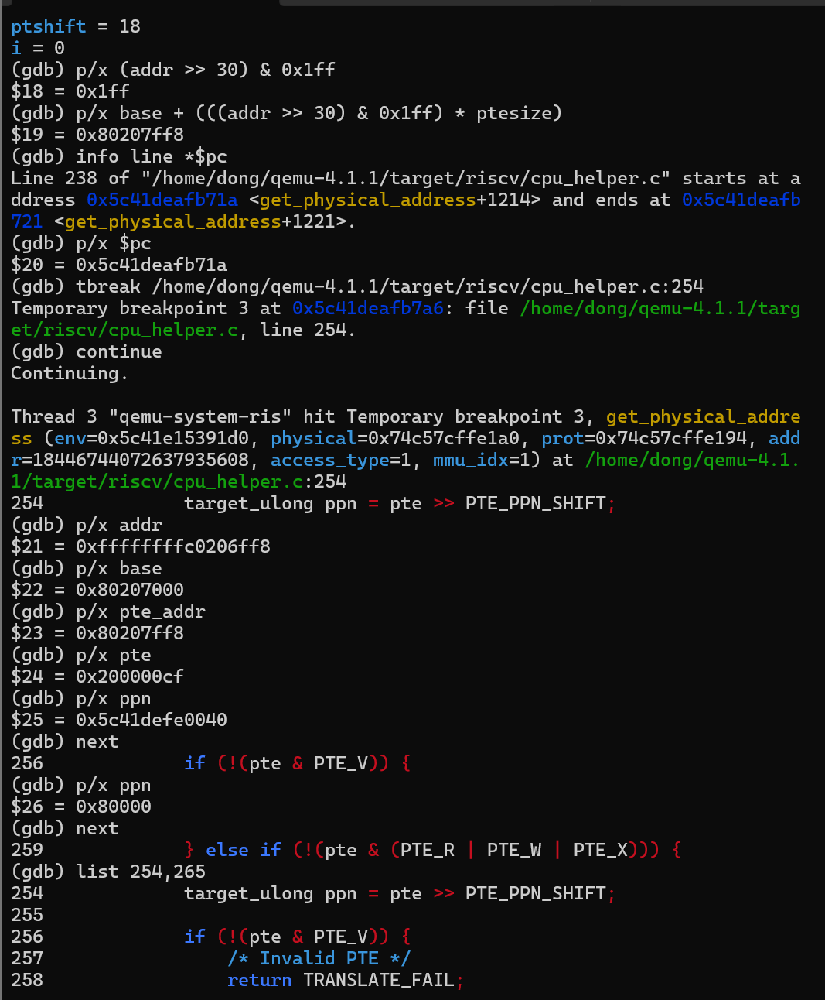
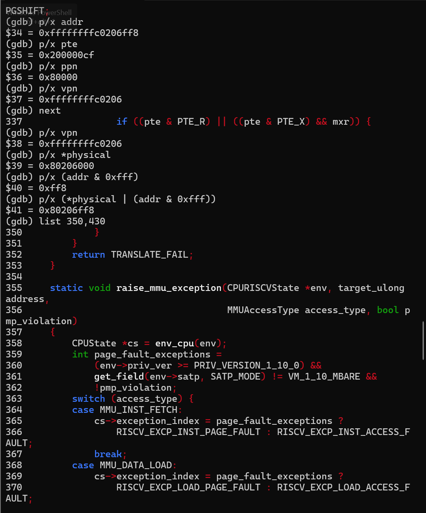
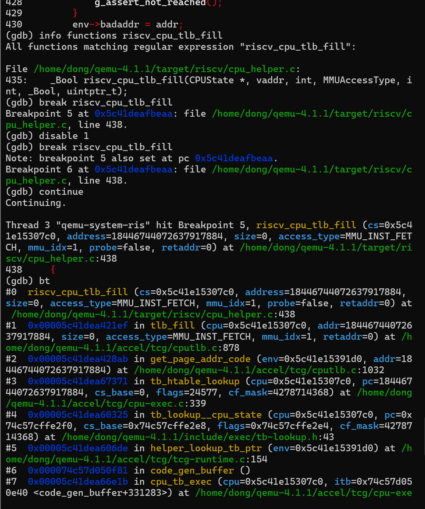

# 实验报告

## 实验基本信息

| 项目 | 内容 |
|---|---|
| **实验名称** | Lab2：物理内存与页表 |
| **小组成员** | 2510720董隽仪 2512607董语晗 2513328何妍希 |
| **完成日期** | 2026-10-25 |

### 小组分工

| 成员 | 代码/实验负责内容 | 报告负责内容 |
|---|---|---|
| 2510720董隽仪 | First-Fit 分析、Best-Fit | 实验目的、整体流程、模块二任务一、任务二 |
| 2512607董语晗 | Buddy 实现与测试、双重 GDB 调试 | 模块二任务三、GDB 分支任务、测试与验证 |
| 2513328何妍希 | 物理内存探测与页描述符初始化、SLUB 扩展 | 模块一、Challenge、总结 |

## 一、实验目的

1. 理解操作系统如何从设备树获取物理内存信息，并区分硬件报告的内存、内核能够管理的内存和真正可分配的页面。
2. 掌握物理地址、内核虚拟地址、物理页号与 `struct Page *` 之间的关系，正确完成页描述符初始化和保留区保护。
3. 理解 First-Fit，完成 Best-Fit 和 Buddy，比较它们的搜索、拆分、合并及碎片特征。
4. 设计与 Buddy 实际实现相匹配的测试，通过链表不变量、计数守恒、请求大小记录及边界检查验证正确性。
5. 通过简化 SLUB 了解页级分配与对象级分配的两层架构。
6. 通过双重 GDB 调试观察 QEMU 中的 SV39 页表查询与软件 TLB，建立内核代码、架构规则和模拟器实现之间的联系。
7. 学习把接口、前置条件、不变量和测试标准写入提示词，以实际代码及运行结果检验 AI 输出。

---

## 二、实验环境

| 项目 | 环境或依据 |
|---|---|
| 宿主环境 | Windows + WSL；已有 GDB 记录注明 Ubuntu 22.04 |
| 模拟平台 | QEMU `virt`，RISC-V 64 位 |
| QEMU | 双重调试记录使用 QEMU 4.1.1，源码目录 `/home/dong/qemu-4.1.1` |
| 固件 | 运行日志显示 OpenSBI v0.4，Runtime SBI v0.1 |
| 内存 | DTB 报告起点 `0x80000000`、大小 `0x08000000`，即 128 MiB |
| 编译工具 | GNU Make、`riscv64-unknown-elf-gcc` 等交叉工具链；具体版本待补 |
| 调试工具 | 宿主 GDB、`riscv64-unknown-elf-gdb`、QEMU GDB stub |
| 主机测试 | 普通 GCC 编译 `tools/buddy_host_test.c`；不执行 RISC-V 指令 |

### AI 工具

| 成员           | AI 编程工具 | 底层模型 |
| -------------- | ----------- | -------- |
| 2510720-董隽仪 | Chat GPT    | GPT-5.6  |
| 2512607-董语晗 | Chat GPT    | GPT-6.1  |
| 2513328-何妍希 | Chat GPT    | GPT-6.1  |

---

## 三、实验整体逻辑分析

### 3.1 本章节的逻辑主线

本实验解决“内核启动后，如何安全地组织和分配物理内存”的问题。首先需要知道内存在哪里，再排除已占用部分，最后才能讨论采用哪种分配算法。如果初始化时错误地把内核代码、页表或描述符数组交给分配器，即使分配算法本身正确，也会破坏正在运行的系统。

主线可概括为：

```text
OpenSBI 传递 hartid / DTB 地址
  → kern_entry 保存启动参数并设置 satp
  → kern_init 清零 BSS、解析 DTB、初始化控制台
  → pmm_init
      → init_pmm_manager：选择算法并初始化内部状态
      → page_init：确定可管理范围、建立 Page 数组、保留已占用页
          → init_memmap：注册真正可用的完整页
      → check_alloc_page：执行当前管理器的自检
  → alloc_pages / free_pages 提供页级分配接口
  → SLUB 可在其上提供 kmalloc / kfree 对象接口
```

页表与分配器分别处理地址转换和资源管理。当前启动代码已经启用 SV39；后续在 `page_init()` 中初始化分配器，不意味着此时才第一次开启分页。

### 3.2 功能的逐步实现

1. **先完成物理内存初始化。** 统一虚实地址转换，明确哪些页能够交给管理器。
2. **理解 First-Fit。** 借助完整参考实现掌握空闲链表、块头标志和分裂合并约定。
3. **实现 Best-Fit。** 在同一接口下改变候选块选择策略，保持页面回收和相邻块合并语义。
4. **实现 Buddy 并单独设计测试。** 引入按阶链表、2 的幂次对齐与伙伴递归合并，明确请求页数和实际占用不同。
5. **编写 SLUB 扩展。** 在页面分配之上切分小对象，避免每个小对象单独占据一整页。
6. **进行 QEMU/GDB 调试。** 从另一层面观察虚拟地址怎样通过 TLB 和页表转成物理地址。

---

## 四、实验内容与实现

## 功能模块一：物理内存初始化

**负责人：**2513328 何妍希

### 1. 实验目的

本模块的主要目标是实现操作系统启动阶段的物理内存探测与页描述符初始化。内核需要从设备树中取得机器的物理内存起始地址和容量，建立物理页对应的 `Page` 描述符数组，排除 OpenSBI、内核镜像以及描述符数组本身占用的区域，最后将剩余的完整物理页交给物理内存管理器管理。

通过本模块，进一步理解物理地址、虚拟地址、物理页号和 `Page` 描述符之间的关系，并掌握操作系统启动时构建物理内存管理初始状态的过程。

### 2. 任务一：物理内存探测与页描述符初始化

#### 2.1 任务内容

本任务要求补充 `kern/mm/pmm.c` 中的 `page_init()` 函数，实现以下功能：

1. 设置内核虚拟地址与物理地址之间的固定偏移；
2. 从设备树中取得物理内存起始地址和容量；
3. 计算内核能够管理的物理内存上界；
4. 初始化物理页描述符数组 `pages`；
5. 将所有物理页暂时标记为保留状态；
6. 排除 OpenSBI、内核镜像和描述符数组占用的区域；
7. 将剩余完整页面注册到当前物理内存管理器。

#### 2.2 关键变量说明

`va_pa_offset` 表示内核虚拟地址和物理地址之间的固定偏移量，二者满足：

```
虚拟地址 = 物理地址 + va_pa_offset
```

实验中首先设置：

```
va_pa_offset = PHYSICAL_MEMORY_OFFSET;
```

这是因为后续的 `PADDR()` 宏需要通过该偏移量将内核虚拟地址转换为物理地址。

`nbase` 表示 DRAM 第一个物理页面的页号：

```
const size_t nbase = DRAM_BASE / PGSIZE;
```

在本实验中，DRAM 从物理地址 `0x80000000` 开始，页大小为 4096 字节，因此：

```
nbase = 0x80000000 / 0x1000 = 0x80000
```

`npage` 并不是简单的“可用物理页数量”，而是内核能够管理的物理页号上界。在完成物理内存探测前，实际内存上界尚未确定，因此它最初被初始化为 0：

```
size_t npage = 0;
```

读取设备树并确定内存末端后，再进行赋值：

```
npage = PPN(maxpa);
```

例如物理内存末端为 `0x88000000` 时：

```
npage = 0x88000000 / 0x1000 = 0x88000
```

因此，本次实验实际需要建立描述符的 DRAM 页面数量为：

```
npage - nbase = 0x88000 - 0x80000
                  = 0x8000
                  = 32768 页
```

#### 2.3 设备树物理内存探测

实验使用以下接口读取设备树中记录的物理内存信息：

```
uint64_t mem_base = get_memory_base();
uint64_t mem_size = get_memory_size();
```

其中：

- `mem_base` 为 DRAM 起始物理地址；
- `mem_size` 为 DRAM 总容量；
- `mem_base + mem_size` 为物理内存的开区间末端。

本次 QEMU 运行时探测到：

```
Base: 0x0000000080000000
Size: 0x0000000008000000 (128 MB)
End:  0x0000000087ffffff
```

即物理内存范围为：

```
[0x80000000, 0x88000000)
```

程序同时检查设备树信息是否有效，以及 `mem_base + mem_size` 是否发生无符号整数溢出。如果设备树没有提供有效内存信息，则调用 `panic()` 停止初始化，避免后续使用错误地址破坏内存。

由于当前启动页表只能访问 `PHYSICAL_MEMORY_END` 以内的物理内存，所以即使设备树报告了更大的内存，也必须截断：

```
uint64_t maxpa = detected_mem_end;

if (maxpa > PHYSICAL_MEMORY_END) {
    maxpa = PHYSICAL_MEMORY_END;
}
```

物理内存末端还需要向下按照页面大小对齐，保证交给物理内存管理器的都是完整页面：

```
maxpa = ROUNDDOWN(maxpa, PGSIZE);
```

#### 2.4 页描述符数组初始化

每个物理页面都由一个 `struct Page` 结构进行描述。描述符数组被放置在内核镜像末尾 `end` 之后：

```
pages = (struct Page *)ROUNDUP((uintptr_t)end, PGSIZE);
```

这里对 `end` 进行向上页对齐，可以避免内核镜像末尾与描述符数组共享同一个页面。

描述符数组需要描述 `[nbase, npage)` 范围内的所有 DRAM 页面，因此描述符数量为：

```
size_t page_count = npage - nbase;
```

计算描述符数组末端时，`pages` 是内核虚拟地址，而 `maxpa` 是物理地址，二者不能直接比较。因此需要先使用 `PADDR()` 将描述符数组末端转换为物理地址：

```
uintptr_t pages_end_va = (uintptr_t)(pages + page_count);
uintptr_t pages_end_pa = PADDR(pages_end_va);
```

如果描述符数组末端超过了可管理物理内存末端，则说明没有足够空间保存描述符，内核应通过 `panic()` 停止运行。

#### 2.5 保留页与空闲页划分

初始化时先将所有物理页标记为保留：

```
for (size_t i = 0; i < page_count; i++) {
    pages[i].flags = 0;
    pages[i].property = 0;
    set_page_ref(&pages[i], 0);
    SetPageReserved(&pages[i]);
}
```

这样可以保证 OpenSBI、内核镜像、描述符数组以及地址对齐产生的空隙不会被错误地分配出去。

描述符数组之后的第一个完整页面作为空闲内存起点：

```
uintptr_t free_begin = ROUNDUP(pages_end_pa, PGSIZE);
```

空闲内存末端为已经向下页对齐的 `maxpa`：

```
uintptr_t free_end = maxpa;
```

仅当范围内至少存在一个完整页面时，才调用：

```
init_memmap(pa2page(free_begin), free_page_count);
```

把空闲页面交给当前物理内存管理器。若 `free_begin >= free_end`，则不存在可用完整页面，此时不能以页数 0 调用 `init_memmap()`。

#### 2.6 初始化流程总结

本任务的主要执行流程如下：

```
pmm_init()
  ├── init_pmm_manager()
  │     └── 初始化物理内存分配器
  │
  ├── page_init()
  │     ├── 设置虚拟地址与物理地址偏移
  │     ├── 从设备树读取内存范围
  │     ├── 计算 npage
  │     ├── 建立 Page 描述符数组
  │     ├── 将所有页面标记为保留
  │     └── 注册真正可用的空闲页面
  │
  └── check_alloc_page()
        └── 检查页面分配和释放功能
```

### 3. 本任务使用的提示词

```
[PROMPT]

请补充 uCore Lab2 中 kern/mm/pmm.c 的 page_init() 函数，
根据设备树提供的物理内存信息完成物理内存探测、Page 描述符
数组初始化和空闲物理页面注册。

[RELY]

1. get_memory_base() 返回设备树中的 DRAM 起始物理地址。
2. get_memory_size() 返回设备树中的 DRAM 容量。
3. PGSIZE 为物理页大小。
4. PPN(addr) 可以将物理地址转换为物理页号。
5. ROUNDUP 和 ROUNDDOWN 可以完成页面对齐。
6. PADDR(kva) 可以将内核虚拟地址转换为物理地址。
7. pa2page(pa) 可以将物理地址转换为 Page 描述符地址。
8. init_memmap(base, n) 可以将连续空闲页面交给当前物理内存管理器。
9. end 是内核镜像结束位置。
10. pages、npage、nbase 和 va_pa_offset 已在 pmm.c 中定义。

[GUARANTEE]

Pre:
1. init_pmm_manager() 已经完成。
2. 设备树已经由 dtb_init() 解析。
3. 当前物理内存管理器已经完成内部状态初始化。

Post:
1. 正确设置 va_pa_offset。
2. 正确设置 npage 和 pages。
3. 输出设备树探测到的物理内存范围。
4. 所有 Page 描述符均完成初始化。
5. OpenSBI、内核镜像和描述符数组占用页面不会进入空闲区。
6. 所有剩余完整页面通过 init_memmap() 注册。
7. 设备树信息无效或描述符数组越界时调用 panic()。
8. 没有可用完整页面时不调用 init_memmap()。

[SPECIFICATION]

Case 1:
当设备树报告物理内存范围为
[0x80000000, 0x88000000) 时，应将可管理物理内存上界
设置为 PPN(0x88000000)。

Case 2:
如果设备树报告的内存超过 PHYSICAL_MEMORY_END，
则按照 PHYSICAL_MEMORY_END 截断。

Case 3:
描述符数组从 ROUNDUP(end, PGSIZE) 开始，并确认其末端
不超过物理内存上界。

Case 4:
先把所有页面标记为 Reserved，再只将描述符数组之后的
完整页面交给 init_memmap()。

Requirements:
1. 必须区分虚拟地址、物理地址、物理页号和 Page 指针。
2. 所有空闲区边界必须按照 PGSIZE 对齐。
3. 检查设备树返回值和地址加法溢出。
4. 不修改 pmm_manager 的现有接口。
5. 不把内核及描述符数组所在页面加入空闲区。
6. 代码应能够通过编译和 check_alloc_page() 检查。
```

### 4. 运行结果与分析

完成 `page_init()` 后，使用以下命令编译运行：

```
make clean
make
make qemu
```

QEMU 输出的关键内容为：

```
Physical Memory from DTB:
  Base: 0x0000000080000000
  Size: 0x0000000008000000 (128 MB)
  End:  0x0000000087ffffff

physical memory map:
  memory: 0x0000000008000000,
  [0x0000000080000000, 0x0000000087ffffff].

check_alloc_page() succeeded!
```

### 5. 扩展任务 Challenge：硬件可用物理内存范围的获取方法

#### 5.1 问题

如果操作系统无法提前知道当前硬件的可用物理内存范围，应如何让操作系统获得可用物理内存范围？

#### 5.2 回答

操作系统通常不应该通过盲目读写所有地址来猜测物理内存容量，而应该由启动固件或引导程序完成硬件探测，再将内存布局传递给操作系统。

不同体系结构和启动方式通常采用以下方法：

1. **设备树 Device Tree**

   在 RISC-V、ARM 等平台中，固件或引导程序可以把设备树地址传递给内核。设备树中的 `/memory` 节点记录物理内存的起始地址和长度，`/reserved-memory` 节点记录不可由普通内存分配器使用的保留区域。

   本实验采用的就是这种方法。OpenSBI 启动内核时传递设备树地址，内核通过 `dtb_init()` 解析设备树，再由 `get_memory_base()` 和 `get_memory_size()` 取得物理内存范围。

2. **BIOS 内存映射**

   在传统 x86 平台中，引导程序可以调用 BIOS E820 接口获取内存映射。返回结果不仅包含可用 RAM，还会标明保留区域、ACPI 区域和设备占用区域。

3. **UEFI Memory Map**

   使用 UEFI 启动时，引导程序可以调用 `GetMemoryMap()` 获得内存描述符数组，并在退出启动服务前把该内存映射传递给内核。

4. **引导程序传递启动参数**

   U-Boot、GRUB 等引导程序在加载内核前已经掌握部分硬件信息，可以通过设备树、Multiboot 信息结构或自定义启动参数将内存布局交给内核。

5. **硬件探测**

   如果固件和引导程序都无法提供内存布局，内核理论上可以尝试访问不同物理地址进行探测。但这种方法风险较大，因为某些地址可能对应内存映射设备、保留区域或不存在的总线地址，访问后可能产生异常或破坏设备状态。因此硬件探测只适合特定平台下的受控场景，不能作为通用首选方案。

#### 5.3 可用物理内存的最终确定

固件提供的内存范围通常只是“机器安装的物理内存”，不代表这些内存全部可以立即分配。操作系统还必须从中排除：

- 固件或 OpenSBI 占用区域；
- 内核代码段、数据段和内核栈；
- 页表占用区域；
- `Page` 描述符数组；
- 设备树本身；
- `/reserved-memory` 指定区域；
- 内存映射 I/O 区域；
- 其他平台保留区域。

因此，可用物理内存可以表示为：

```
可用物理内存 = 固件报告的物理内存 - 固件保留区域 - 内核占用区域 - 页表及管理结构占用区域 - 设备和其他保留区域
```

在本实验中，设备树提供 DRAM 起点和容量，而 `page_init()` 负责进一步排除内核和页描述符数组占用的内存，最终把剩余的完整页面交给物理内存管理器。

### 功能模块二：物理内存分配

#### 任务一：理解 First-Fit

**负责人：**2510720 董隽仪

**1.** **初始化空闲页**

在 `default_pmm.c` 中，`default_init()` 首先调用 `list_init(&free_list)` 初始化空闲链表，并将空闲页总数 `nr_free` 设为 0。随后，`default_init_memmap()` 对可用物理页进行初始化，清除页面标志和引用计数，并将连续的空闲物理页作为一个空闲块进行管理。其中，`base->property = n` 用于记录空闲块包含的页数，`SetPageProperty(base)` 用于标记该页面是空闲块的起始页。最后，函数将该空闲块按照物理地址顺序插入空闲链表，并更新空闲页总数 `nr_free`。

**2.** **分配连续物理页**

`default_alloc_pages(size_t n)` 负责分配连续的物理页。函数首先检查申请的页数是否大于当前空闲页总数，如果大于则返回 `NULL`。接着，从空闲链表头部开始依次查找，使用 `p->property >= n` 判断当前空闲块是否满足申请要求。First-Fit 算法找到第一个足够大的空闲块后，就停止查找并进行分配。如果空闲块大小恰好等于申请数量，则直接将其从空闲链表中移除；如果空闲块更大，则将其分割，保留剩余的空闲部分并重新加入链表。分配完成后，函数通过 `nr_free -= n` 更新空闲页总数，并清除已分配块起始页的空闲块标志。

**3.** **回收页面并合并相邻空闲块**

`default_free_pages(struct Page *base, size_t n)` 负责回收连续的物理页。函数首先检查待释放页面的状态，重置其标志和引用计数，再将它们作为一个新的空闲块加入空闲链表，并通过 `nr_free += n` 更新空闲页总数。为了减少内存碎片，函数随后检查新释放的空闲块与前一个空闲块是否在物理地址上连续。如果连续，就合并两个空闲块，并更新块大小和链表信息。之后，再检查与后一个空闲块是否连续；如果连续，也进行合并。通过这种方式，相邻的空闲块可以合并成更大的空闲块，从而提高后续申请较大连续物理内存的成功率。

**4.** **原有的 First-Fit** **算法是否有进一步的改进空间？**

First-Fit 算法实现简单，找到第一个满足要求的空闲块后就停止查找，因此通常具有较好的查找效率。但当空闲块较多时，仍需要依次遍历链表，查找时间可能增加；反复分割空闲块也可能产生较多小块，造成外部碎片。可以考虑采用 Best-Fit 算法，每次选择能够满足申请需求的最小空闲块，以减少较大空闲块被不必要地分割，但这种方法也可能增加查找开销，并产生难以利用的小碎片。其次，可以使用更高效的数据结构或分级空闲链表，减少查找空闲块的时间。此外，还可以进一步优化空闲块的分割与合并策略，以减少内存碎片。实际选择时，需要综合考虑分配速度、内存利用率和实现复杂度。

#### 任务二：Best-Fit 连续物理内存分配算法实现

**负责人：**2510720 董隽仪

#### 模块功能描述

本任务要求在 riscv64-uCore 操作系统实验项目中实现 Best-Fit 连续物理内存分配算法，使系统能够根据申请的连续物理页面数量，从现有空闲内存块中选择合适的内存块完成分配。

本任务主要涉及 `kern/mm/best_fit_pmm.c` 和 `kern/mm/pmm.c`。前者负责实现 Best-Fit 内存管理器的具体功能，后者负责在 `init_pmm_manager()` 中选择该管理器，使系统实际使用 Best-Fit 算法。

与 First-Fit 算法找到第一个满足条件的空闲块就停止搜索不同，Best-Fit 需要遍历空闲链表，选择能够满足分配需求且大小最小的空闲块。分配后，如果原内存块还有剩余空间，则将剩余部分重新纳入空闲内存管理；释放页面时，则需要维护空闲链表、更新空闲页面数量，并尝试合并物理地址连续的相邻空闲块。

本任务的实现需要遵循项目现有的 `struct pmm_manager` 接口、`struct Page` 页面描述结构、页面标志和链表操作约定，并保留原有的 `basic_check()` 和 `best_fit_check()` 测试函数。

**核心函数及功能：**

| 函数或模块                 | 主要功能                                             |
| -------------------------- | ---------------------------------------------------- |
| `insert_free_block()`      | 按物理页面地址升序将空闲块插入空闲链表               |
| `best_fit_init()`          | 初始化空闲链表和空闲页面计数                         |
| `best_fit_init_memmap()`   | 初始化一段连续的可用物理页面，并将其登记为空闲块     |
| `best_fit_alloc_pages()`   | 搜索所有满足需求的空闲块，选择最小的合适块并完成分配 |
| `best_fit_free_pages()`    | 释放连续页面、更新空闲页数，并合并相邻空闲块         |
| `best_fit_nr_free_pages()` | 返回当前空闲物理页面总数                             |
| `best_fit_pmm_manager`     | 将各个管理函数注册到统一的物理内存管理器接口         |
| `init_pmm_manager()`       | 选择并启用 Best-Fit 管理器                           |

#### 提示词

```text
[PROMPT]

任务：在 riscv64-uCore 操作系统实验项目中实现 Best-Fit
连续物理内存分配模块。主要修改 kern/mm/best_fit_pmm.c，
并修改 kern/mm/pmm.c 中的 init_pmm_manager()，
使系统实际使用 Best-Fit 物理内存管理器。

操作要求：参考 kern/mm/default_pmm.c 中已有的 First-Fit
实现，阅读 kern/mm/pmm.h 中 struct pmm_manager 的定义，
理解项目现有的内存管理接口和页面状态约定。

在 kern/mm/best_fit_pmm.c 中标记为 lab2 和 YOUR CODE
的位置补全实现，并在 kern/mm/pmm.c 中完成管理器切换。

保留现有代码，不得修改 basic_check() 和 best_fit_check()
两个测试函数的函数体，不得通过修改测试逻辑规避错误。

输出要求：根据 RELY、GUARANTEE 和 SPECIFICATION 中的要求
完成模块实现。优先直接修改项目中的实际文件；如果无法访问
项目文件，则给出可以放入对应位置的完整代码。

实现完成后使用项目现有的编译和测试流程验证正确性，
不得引入与本任务无关的功能。


[RELY]

相关文件：
- kern/mm/default_pmm.c：提供 First-Fit 物理内存管理器的参考实现。
- kern/mm/best_fit_pmm.c：提供 Best-Fit 模块的代码位置和已有测试函数。
- kern/mm/pmm.h：定义物理内存管理器接口。
- kern/mm/pmm.c：负责选择当前使用的物理内存管理器。

接口定义：
struct pmm_manager 包含管理器名称、初始化、初始化可用内存区域、
分配连续页面、释放连续页面、统计空闲页面以及执行检查的函数指针。
具体函数签名和类型必须以项目实际的 pmm.h 为准。

相关状态：
项目通过 struct Page 描述物理页面，通过页面标志区分保留页面
和空闲块起始页面，并使用 property 记录空闲连续块的页面数量。
空闲链表用于维护可分配的连续页面，空闲页计数用于记录可用页面总数。
所有页面状态、链表操作和地址关系必须符合项目已有定义。


[GUARANTEE]

必须实现与 struct pmm_manager 接口相匹配的初始化函数、
可用内存区域初始化函数、连续页面分配函数、
连续页面释放函数和空闲页面统计函数，并定义
best_fit_pmm_manager 注册结构，将这些函数正确关联。

允许增加仅供本模块内部使用的辅助函数和静态变量，
但不得改变项目已有的公开接口。

必须在 kern/mm/pmm.c 的 init_pmm_manager() 中选择
best_fit_pmm_manager，确保系统实际使用 Best-Fit 管理器。

必须保留 basic_check() 和 best_fit_check() 两个测试函数的
原有函数体、断言和测试逻辑。可以通过函数声明引用已有测试函数，
但不得修改、删除或绕过测试函数。


[SPECIFICATION]

1. 物理内存管理器初始化

前置条件：内核开始初始化物理内存管理器。

后置条件：管理器内部用于维护空闲内存的状态被正确初始化，
空闲页面计数处于初始状态，后续可以接收可用物理内存区域。

2. 可用物理内存区域初始化

前置条件：输入参数指向一段符合项目状态约定的连续物理页面，
页面数量大于零。

后置条件：输入区域被正确初始化为空闲内存块并纳入管理器维护。
空闲块大小、页面标志、链表状态和空闲页计数保持一致，
不得重复登记页面。

3. 连续物理页面分配

前置条件：请求分配的页面数量大于零，管理器状态合法。

后置条件：如果存在足够大的连续空闲内存块，则选择其中满足请求
且大小最小的空闲块，实现 Best-Fit 分配策略。

分配完成后，已分配页面不再被视为空闲页面；如果原空闲块大于
请求数量，剩余页面仍须作为合法的空闲区域进行管理。

如果不存在满足请求的空闲块，则返回失败结果，
且原有空闲状态保持不变。

4. 连续物理页面释放

前置条件：输入参数指向符合项目释放约定的连续已分配页面，
页面数量大于零。

后置条件：释放的页面重新成为可用页面，空闲块信息和空闲页计数
正确更新。如果释放区域与相邻空闲区域在物理地址上连续，
则应将它们合并。释放完成后，空闲链表及页面状态保持一致。

5. 空闲页面数量统计

前置条件：管理器已经初始化，内部状态合法。

后置条件：返回当前可用物理页面总数，且返回值与空闲内存管理
结构记录的页面总数一致。

6. 管理器注册与系统切换

前置条件：Best-Fit 管理函数已经实现。

后置条件：best_fit_pmm_manager 中的各函数指针正确指向对应实现，
检查接口关联原有的 best_fit_check()。

init_pmm_manager() 选择该管理器后，内核实际执行的是
Best-Fit 管理逻辑，而不是 First-Fit。

7. 正确性验证

实现必须符合 basic_check() 和 best_fit_check() 对页面标志、
空闲块大小、空闲页计数、分配结果和相邻块合并行为的要求。

必须保持两个测试函数不变，并通过项目现有测试流程验证实现。
若测试失败，应修复管理器实现，而不是修改测试逻辑。
```

#### 实现思路与关键代码分析

**1. 初始化空闲内存管理结构**

`best_fit_init()` 使用 `list_init(&free_list)` 初始化空闲链表，并将 `nr_free` 设为 0。

`best_fit_init_memmap()` 遍历传入的连续页面，检查页面原先处于保留状态，然后清除相关标志、重置引用计数和页面属性。随后将连续页面的数量记录在首页面的 `property` 中，设置 `PG_property` 标志，增加空闲页面计数，并调用 `insert_free_block()` 将空闲块插入链表。

**2. 按 Best-Fit 策略分配页面**

`best_fit_alloc_pages(n)` 首先检查申请页面数量是否大于 0。如果申请数量超过空闲页面总数，则返回 `NULL`。

随后遍历整个空闲链表，对每个空闲块检查其 `property` 是否满足申请数量。如果满足，并且当前块比此前选中的候选块更小，就更新最佳候选块。

找到最佳候选块后，程序将其从空闲链表中移除并清除首页面的空闲块标志。如果该块大于申请数量，就从 `best + n` 开始建立剩余空闲块，并重新插入链表。最后将 `nr_free` 减去实际分配的页面数，并返回分配块的首页面。

该过程体现了 Best-Fit 与 First-Fit 的主要区别：Best-Fit 需要遍历候选空闲块并进行大小比较。

**3. 释放页面并合并相邻空闲块**

`best_fit_free_pages(base, n)` 首先检查释放数量是否大于 0，并检查待释放页面不是保留页面，也不是已经登记为空闲块起始位置的页面。随后清除页面状态、重置引用计数，将释放区域的页面数量记录到首页面的 `property` 中，设置空闲块标志，并增加 `nr_free`。

释放区域按地址顺序插入链表后，程序先检查前一个空闲块是否与当前区域连续，再检查后一个空闲块是否与合并后的区域连续。满足连续条件时，更新合并后的页面数量、清除被合并块首页面的标志，并从链表中移除该块。

这样可以减少相邻空闲区域被分割管理的情况。

**4. 注册管理器并切换算法**

`best_fit_pmm_manager` 通过函数指针关联初始化、内存区域初始化、分配、释放、空闲页面数量查询和检查函数。

在 `kern/mm/pmm.c` 的 `init_pmm_manager()` 中，需要将当前管理器设置为：

```c
pmm_manager = &best_fit_pmm_manager;
```

这样，系统通过统一的物理内存管理接口执行操作时，才会调用 Best-Fit 的具体实现。

#### 测试与验证

本任务应使用实验项目现有的编译和测试流程验证实现。测试命令为：

```bash
export PATH="$HOME/opt/qemu-4.1.1/bin:$PATH"
cd "/mnt/e/lab2"
make test
```

标志成功的关键输出为：

```text
memory management: best_fit_pmm_manager
physical memory map:
  memory: 0x0000000008000000,
  [0x0000000080000000, 0x0000000087ffffff].
check_alloc_page() succeeded!
```

测试截图：


**结果分析：**

1. `memory management: best_fit_pmm_manager` 表明系统选择了 Best-Fit 物理内存管理器。
2. `physical memory map` 输出表明系统打印了探测到的物理内存区域信息。
3. `check_alloc_page() succeeded!` 表明页面分配检查函数执行成功。

#### 4.8 任务三：Buddy System 实现

**负责人： **2512607 董语晗

```c
static void buddy_init(void);
static void buddy_init_memmap(struct Page *base, size_t n);
static struct Page *buddy_alloc_pages(size_t n);
static void buddy_free_pages(struct Page *base, size_t n);
static size_t buddy_nr_free_pages(void);
static void buddy_check(void);
```

实现位于 `kern/mm/buddy_pmm.c`，由 `buddy_pmm.h` 导出管理器。`pmm.c` 中包含头文件并选择 `&buddy_pmm_manager`。

**数据结构和状态约定：**

| 项目 | 作用 |
|---|---|
| `free_lists[0..15]` | 第 k 阶链表管理长度为 `1 << k` 页的空闲块 |
| `nr_free` | 实际空闲物理页总数 |
| `PageProperty` | 只表示空闲块头；已分配块不设置 |
| `property` | 空闲块头或已分配块头的实际块页数，内部页为 0 |
| `requested[index]` | 已分配块头的原请求页数，其他位置为 0 |
| `region[index]` | 初始化区域标识，不同调用注册的区域不相互合并 |

当前页容量为 32768，两个 `unsigned int` 元数据数组共占 256 KiB，保存在内核 BSS。因为 `page_init()` 从链接符号 `end` 之后布置描述符和空闲区，这些数组本身会被自动保留。新增这些元数据和测试快照后，日志中的内核内存占用变大是预期现象。

**初始化：** `buddy_init()` 初始化各阶链表、计数及元数据。`buddy_init_memmap()` 验证传入页均保留且未注册，解除该区域的保留标记；从当前位置选取能放入剩余范围且物理页号对齐的最大块。因而区域长度不必为 2 的幂，起点也不必满足最大阶对齐。

**分配：** 把 `n` 向上取整至 `2^ceil(log2(n))` 页，从目标阶向上找非空链表。找到大块后反复二分，保留低地址半块继续分裂，把高地址半块放入对应链表。最终记录原请求和实际块大小，空闲页数按实际占用扣减。

**释放：** 调用者须传入原块首地址和原请求页数。不支持 First-Fit 测试中的部分释放。例如 `alloc_pages(3)` 占用 4 页，必须使用 `free_pages(base, 3)`，不能释放 `base+1` 或改传 4。释放前核验请求记录、块大小、对齐、页状态及区域归属。

伙伴位置按物理页号计算：

```c
size_t buddy_ppn = page2ppn(base) ^ block_size(order);
```

只有伙伴页号在 `[nbase,npage)` 内、块整体未越界、区域标识相同、伙伴为空闲块头且阶数相同时才合并。合并后取低地址块为首地址并升阶。对 `struct Page *` 的指针地址直接异或会受描述符大小和数组位置影响，不能正确表示物理伙伴。

**Spec 的关键约束：** 物理页号对齐；请求数与占用数分开；空闲计数守恒；块内元数据一致；合并不得越界、跨区域或接触保留页；错误释放必须在修改链表前被拒绝。原始指针接口无法识别地址和大小恰好被重新分配后的过期指针，调用者仍必须维护所有权。

**两份提示词：** 
```
# Buddy System 分配器实现 Prompt
## [PROMOT]任务说明：
1.任务：我正在完成 RISC-V uCore 操作系统 Lab2 的物理内存管理实验，需要在现有物理内存管理框架中从零实现 Buddy System（伙伴系统）分配算法。

2.操作要求：你必须在项目中修改实际文件，保留现有代码，只在标记位置补全。

3.输出要求：直接进行文件操作，使用下面部分的信息。完成后，请提供给我你进行了修改的文件的清单，以及我自行使用虚拟机进行编译和运行的方法。
## [RELY]上下文信息：
请先阅读我提供的以下文件：

• kern/mm/pmm.h
• kern/mm/pmm.c
• kern/mm/default_pmm.c
• kern/mm/memlayout.h
• 项目根目录的 Makefile

以及你认为有必要的文件夹内文件。
## [GUARANTEE]接口清单：
一、实现目标

新增 kern/mm/buddy_pmm.c 和 kern/mm/buddy_pmm.h，实现完整的 Buddy System 物理内存管理器，并通过 struct pmm_manager 接口接入内核。

二、接口兼容要求

• 遵守现有 alloc_pages(n) 和 free_pages(base, n) 接口。
• 明确区分请求页数与实际占用的 2 的幂次页数。
• 说明如何记录实际分配块大小，避免释放时出现重复释放、内存泄漏或错误合并。
• 不得越过实际可管理的物理内存范围。
• 正确维护 PageReserved、PageProperty 和 property。
• 伙伴位置应根据物理页索引计算，不得直接对指针地址进行异或。
• 不得破坏现有 First-Fit 和 Best-Fit 实现。

三、接入要求

说明如何修改 pmm.c 中的 init_pmm_manager()，使内核使用 buddy_pmm_manager。

检查 Makefile 是否会自动编译新增源文件。

要求代码兼容现有 RISC-V uCore 项目，不能使用标准 C 库中的 malloc/free，也不能依赖项目中不存在的函数。
## [SPECIFICATION]行为规格
1. 参考 default_pmm.c 的代码风格和接口实现。
2. 使用多级空闲链表管理不同阶数的内存块，每个块大小为 2 的整数次幂个物理页。
3. 使用现有的 struct Page、list_entry_t 和页面状态宏，尽量不修改已有数据结构。
4. 实现 buddy_init()，初始化各阶空闲链表及空闲页计数。
5. 实现 buddy_init_memmap()，将初始空闲物理页区域按照地址对齐要求拆分为合法的伙伴块，正确处理区域起点不对齐及页数不是 2 的幂的情况。
6. 实现 buddy_alloc_pages()，将请求页数向上取整到 2 的幂次，寻找合适空闲块，必要时拆分更大的块。
7. 实现 buddy_free_pages()，正确处理释放请求，判断伙伴块是否空闲且属于同一合法管理区域，并进行递归合并。
8. 实现 buddy_nr_free_pages()，正确统计空闲物理页数量。
9. 定义 buddy_pmm_manager，完成所有函数指针的注册。
10. 保证不会将 OpenSBI、内核或其他保留页加入空闲链表。


# Buddy System 伙伴系统测试函数设计 Prompt
## [PROMOT]任务说明：
1.任务

我正在完成 RISC-V uCore 操作系统 Lab2 的物理内存管理实验。目前已经根据第一份 Prompt 实现了 Buddy System 伙伴系统物理内存分配器，并将其接入现有的 uCore 物理内存管理框架。

现在需要为已经实现的 Buddy System 设计完整的测试函数，验证伙伴系统的内存分配、释放、拆分、合并以及边界情况是否正确。

请根据我的实际代码设计测试，不要直接照搬 First-Fit 的测试函数。

2.操作要求

你必须在项目中修改实际文件，保留现有代码，只在标记位置补全。

3.输出要求：直接进行文件操作，使用下面部分的信息。完成后，请提供给我你进行了修改的文件的清单。说明每项测试的目的和预期结果。提供完整的 buddy_check() 及必要的辅助测试函数代码。

## [RELY]上下文信息：
项目使用 RISC-V 架构下的 uCore 操作系统。

现有文件包括：
• kern/mm/pmm.h：定义物理内存管理器统一接口。
• kern/mm/pmm.c：负责初始化、选择和调用物理内存管理器。
• kern/mm/memlayout.h：定义 struct Page、页面状态标志及链表结构。
• kern/mm/default_pmm.c：First-Fit 分配器参考实现。
• kern/mm/buddy_pmm.c：已经实现的 Buddy System 分配器。
• kern/mm/buddy_pmm.h：Buddy System 相关声明。

请首先阅读 buddy_pmm.c 的实际实现，分析其空闲链表组织方式、伙伴地址计算方法、内存块拆分与合并逻辑，再设计相应的测试函数。
## [GUARANTEE]接口清单：
请在 buddy_pmm.c 中实现：static void buddy_check(void);并在管理器注册结构中设置：.check = buddy_check,确保 uCore 执行 pmm_init() 后，可以通过现有的 check_alloc_page() 自动调用 Buddy System 测试函数。

测试实现要求：

使用项目现有的 assert()、cprintf()、alloc_pages()、free_pages()、nr_free_pages() 等接口。需要检查 Buddy System 内部链表状态时，可以使用模块内部辅助函数，但不能破坏分配器的正常工作。

测试必须与当前 buddy_pmm.c 的实际数据结构和算法实现保持一致。

如果需要临时构造独立测试区域，必须确保测试结束后恢复原有管理器状态，不能丢失真实空闲页。

不允许将仍被内核使用的物理页加入测试空闲链表。不允许修改 default_pmm.c 中的 basic_check() 和 default_check()。

测试不得依赖某次运行中特定的内存地址。测试结束后应恢复测试前的空闲页数量及管理状态。如需对某些边界情况进行破坏性测试，应将其设计为独立测试，避免导致内核无法继续启动。

不允许通过修改 Buddy System 核心算法来掩盖测试失败。
## [SPECIFICATION]行为规格
请设计 buddy_check() 测试函数，至少覆盖以下内容。
1. 基本内存分配测试

测试申请 1 页、2 页、4 页、8 页内存。
检查分配结果是否为有效的 struct Page *。
检查不同分配块是否发生内存重叠。
检查分配后的空闲页数量是否正确变化。
检查分配的物理地址是否满足实际分配块的对齐要求。

2. 非 2 的幂次页数分配测试

测试申请 3 页、5 页、7 页内存。
检查 Buddy System 是否按照设计向上取整到 4 页或 8 页的块。
检查实际分配块大小是否被正确记录。
检查释放时是否能够恢复相应的空闲页数量。

3. 内存块拆分测试

构造可控的空闲内存区域。
申请较小的内存块，使伙伴系统必须拆分较大的空闲块。
验证拆分后各阶空闲链表的状态是否正确。
验证剩余内存块仍然可以正常分配。

4. 伙伴块合并测试

分配两个来自同一父块的伙伴块。
分别释放两个伙伴块。
验证两个伙伴块能够合并为更大的空闲块。
继续测试多级递归合并。
验证合并后的大块内存可以重新分配。

5. 内存不足测试

在可控测试区域内逐步耗尽可用物理页。
验证无法满足分配请求时返回 NULL。
验证分配失败不会破坏已有空闲链表。
验证失败前后空闲页计数保持正确。

6. 内存释放与重复利用测试

分配若干内存块后，按照不同顺序释放。
验证释放后的内存能够再次被分配。
验证不会出现内存泄漏、重复分配或错误合并。
测试多次分配和释放后的空闲页总数是否恢复。

7. 边界情况测试

测试只有 1 页、2 页或非 2 的幂次页数的初始空闲区域。
测试起始页号不满足大块对齐要求的情况。
测试伙伴块位于管理区域边界时的合并行为。
验证不会访问管理区域以外的内存。
测试大于当前可用内存的分配请求。
对 n=0 等非法参数，按照现有接口约定处理，不要为了测试而故意触发无法恢复的内核 panic。
测试通过时输出：

Buddy System basic allocation test passed!
Buddy System split test passed!
Buddy System merge test passed!
Buddy System boundary test passed!
Buddy System all tests passed!

以上输出仅应在对应测试全部通过后打印。

五、输出要求

请按以下顺序给出结果：
分析现有 Buddy System 的实现特点。
说明每项测试的目的和预期结果。
提供完整的 buddy_check() 及必要的辅助测试函数代码。
指出需要在 buddy_pmm.c 中添加或修改的位置。
说明如何使用 make 和 make qemu 编译、运行测试。
说明如何判断测试通过。
分析测试可能发现的典型错误，例如错误拆分、错误合并、空闲页计数不一致、内存越界等。
如果现有 Buddy System 的实现无法安全支持某项测试，请明确说明原因，不要凭空假设接口或数据结构存在。
最终代码应能够在当前 uCore 项目中编译运行，并尽可能覆盖 Buddy System 的核心功能和边界情况。
```
#### 4.9 Buddy 测试方案及有效性

测试先通过真实分配器借出 64 页块，保存真实链表头、空闲计数及这 64 页的描述符、请求和区域元数据；然后仅在借用块内构造不同测试区。结束后恢复真实状态并归还借用块。不会把正在使用的内核页临时标为空闲。

| 测试 | 检查内容 | 为什么有效 |
|---|---|---|
| 基本分配 | 1、2、4、8 页；对齐、非重叠、计数 | 同时保留多个分配，避免只测单次成功而漏掉重复分配 |
| 向上取整 | 3、5、7 页分别占 4、8、8 页 | 同时核验块大小、原请求记录与实际计数，检验释放契约 |
| 精确拆分 | 唯一 16 页块中申请 1 页，剩余偏移为 1、2、4、8 | 直接校验各阶链表，不能仅凭总页数正确就判定拆分正确 |
| 伙伴合并 | 四个 4 页块；单边释放、双边释放、递归合并 | 验证只能合并真实伙伴，并能从 4→8→16 恢复大块 |
| 内存不足 | 16 页逐页耗尽；失败前后快照相等 | 验证失败不破坏已分配块、空闲链表和元数据 |
| 重复利用 | 八轮不同释放顺序；最终恢复一个完整块 | 检查非 LIFO 情形及多次操作后的资源守恒 |
| 边界区域 | 1 页、2 页、不对齐两页、不对齐 13 页 | 检查不能简单把区间长度向上取整并越过真实范围 |
| 区域隔离 | 相邻但分别注册的两个 4 页块 | 总空闲页为 8，但不能合成一个跨区域的 8 页块 |
| 全局恢复 | 比较原始空闲总数与每阶块数 | 防止测试本身丢失真实空闲页或改变块结构 |

`test_arena_check()` 还检查页面覆盖、内部页状态、链表双向连接及活动分配的互斥性。主机测试包含 10000 次混合操作、有活动分配时的自检恢复、区域末端恰好等于 `npage` 的场景。重复释放、内部地址释放、错误大小、`alloc_pages(0)` 和零页释放在独立进程中验证断言，避免让启动自检故意 panic。

只有拿到 64 页测试块才能执行完整测试；拿不到时明确输出 skipped，不输出 all tests passed。测试入口已经通过 `.check = buddy_check` 注册，无须手工调用。

#### 4.10 Buddy 实现与测试的实际迭代

| 阶段 | 问题或不足 | 调整及验证 |
|---|---|---|
| 初始算法 | 接口允许请求非幂次页数，释放时容易混淆请求和实际占用 | 增加 requested 记录，property 保存实际块大小，明确原请求释放契约 |
| 初始检查 | 原检查只做若干申请和释放，不能充分证明拆分和合并 | 增加独立测试区、精确链表检查、失败快照和边界用例 |
| 主机声明 | 编辑器对 GNU `__attribute__` / `__noreturn` 声明显示语法红线 | 将 host `exit` 改为普通声明；`__panic` 在 exit 后加无限循环保持不返回保证；严格 GCC 编译通过 |
| 项目构建 | Best-Fit 的实现区为空，导致所有源文件构建失败 | 补齐 Best-Fit，不通过删除构建目标掩盖问题 |
| 首次内核运行 | 输出 `default_pmm_manager`，Buddy 测试没有执行 | 检查真实 pmm.c，切换管理器后清理重编译 |
| 最终内核运行 | 需要确认不仅源码存在，而且实际执行 Buddy | 日志显示 buddy_pmm_manager、五条 passed 及后续 satp 输出 |

```sh
cd /mnt/d/2026/os/lab2/lab2_new
make clean
make -j2
make qemu
```

已有运行记录中的关键输出如下：

```text
Physical Memory from DTB:
  Base: 0x0000000080000000
  Size: 0x0000000008000000 (128 MB)
  End:  0x0000000087ffffff
memory management: buddy_pmm_manager
physical memory map:
  memory: 0x0000000008000000, [0x0000000080000000, 0x0000000087ffffff].
Buddy System basic allocation test passed!
Buddy System split test passed!
Buddy System merge test passed!
Buddy System boundary test passed!
Buddy System all tests passed!
check_alloc_page() succeeded!
satp virtual address: 0xffffffffc0207000
satp physical address: 0x0000000080207000
```

测试截图：




### 4.11 Challenge：简化 SLUB 对象分配器

**负责人：**2513328 何妍希

### 1. 目的

本 Challenge 要求在页级物理内存分配器之上，实现一个能够分配任意大小内存对象的简化 SLUB 分配器，从而减少使用 Buddy System 直接分配小对象造成的内存浪费。

### 2. 设计与实现

本实验采用两层内存分配结构：

```
SLUB 小对象分配器
        ↓
Buddy 物理页分配器
```

SLUB 设置了以下九个对象大小类别：

```
8、16、32、64、128、256、512、1024、2048 字节
```

当申请大小不超过 2048 字节时，选择能够容纳该请求的最小类别。例如，申请 24 字节时使用 32 字节类别。每个 slab 通过 `alloc_page()` 从 Buddy 申请一个 4KB 页面，并将页面剩余空间切分为多个相同大小的对象。

空闲对象使用自身开头保存下一个空闲对象的地址，组成单向空闲链表。分配时从链表头取出对象，释放时再将对象插回链表。当一个 slab 内的对象全部释放后，通过 `free_page()` 将整个页面归还给 Buddy。

对于大于 2048 字节的对象，程序计算所需页数并直接调用 `alloc_pages()`。释放时通过保存的原始请求页数调用 `free_pages()`。

实验新增文件：

```
kern/mm/slub.h
kern/mm/slub.c
```

并在 `kern/init/init.c` 中调用：

```
slub_init();
slub_check();
```

### 3. 使用的提示词

```
提示词一：生成 SLUB 模块

[PROMPT]

请在当前 uCore Lab2 工程中实现一个单核简化版 SLUB 内存分配器。
该分配器位于 Buddy System 物理页分配器之上，为内核提供任意大小
内存对象的分配和释放功能。

[RELY]

1. 工程已经完成 Buddy System。
2. 可以通过 alloc_pages(n) 申请连续物理页。
3. 可以通过 free_pages(page, n) 释放物理页。
4. 可以通过 alloc_page() 和 free_page() 申请或释放单页。
5. PGSIZE 为 4096 字节。
6. page2pa(page) 可以将 Page 转换为物理地址。
7. va_pa_offset 是内核虚拟地址和物理地址之间的固定偏移。
8. 工程提供 list_entry_t 双向链表和 assert、memset、cprintf。

[GUARANTEE]

Pre:

1. pmm_init() 已完成。
2. 当前 pmm_manager 为已经通过检查的 buddy_pmm_manager。
3. SLUB 初始化期间不存在并发访问。

Post:

1. 提供 slub_init()、kmalloc(size) 和 kfree(ptr)。
2. 1～2048 字节使用 8、16、32、64、128、256、512、
   1024、2048 字节大小类别。
3. 每个小对象 slab 使用一个物理页。
4. slab 内使用空闲对象链表管理未分配对象。
5. slab 中对象全部释放后，将页面归还给 Buddy。
6. 大于 2048 字节的请求直接向 Buddy 申请足够多的连续页。
7. kfree(NULL) 不执行任何操作。
8. 释放时能够区分小对象和大对象。
9. 不修改 Buddy System 的分裂、合并和空闲链表算法。

[SPECIFICATION]

Case 1:
输入 kmalloc(24)，选择能够容纳 24 字节的最小大小类别，
即 32 字节 cache。

Case 2:
某个 32 字节 slab 仍有空闲对象时，从其空闲对象链表中
以 O(1) 时间取出对象。

Case 3:
某个 cache 没有可用 slab 时，通过 alloc_page() 从 Buddy
申请一个页面，建立新的 slab，并切分为固定大小对象。

Case 4:
释放小对象时，将对象重新插入对应 slab 的空闲链表。
如果该 slab 的 inuse 变为 0，则通过 free_page() 将页面归还 Buddy。

Case 5:
输入 kmalloc(5000)，计算管理头和对象总共需要的页面数量，
通过 alloc_pages(n) 分配，并保存原始请求页数。

Requirements:

1. 新建 kern/mm/slub.h 和 kern/mm/slub.c。
2. 不扩展 struct Page。
3. 管理信息保存在 slab 页面的开头。
4. 空闲对象本身保存 next 指针。
5. 所有返回地址至少按 8 字节对齐。
6. 添加必要的边界检查和断言。
7. 代码能够通过当前工程编译。
8. 输出清晰的初始化成功信息。

提示词二：生成 SLUB 测试

[PROMPT]

请为当前 uCore Lab2 的简化版 SLUB 分配器编写完整的内核自测函数
slub_check()，验证不同大小对象的分配、访问、释放、复用以及物理页回收。

[RELY]

1. 已提供 slub_init()、kmalloc(size) 和 kfree(ptr)。
2. 已提供 nr_free_pages()，可以取得 Buddy 当前空闲页数量。
3. 已提供 assert、memset 和 cprintf。
4. SLUB 的小对象类别为 8～2048 字节。
5. 大于 2048 字节的对象直接从 Buddy 分配连续页。

[GUARANTEE]

Pre:

1. pmm_init() 已完成。
2. slub_init() 已完成。
3. 测试开始前 Buddy 和 SLUB 状态有效。

Post:

1. 测试覆盖大小类别的边界值。
2. 测试覆盖大于 2048 字节的大对象。
3. 测试验证不同对象之间不会互相覆盖。
4. 测试验证释放对象可以重新使用。
5. 测试采用非顺序释放。
6. 所有测试对象最终全部释放。
7. 测试结束后的 nr_free_pages() 与开始前相等。
8. 所有测试通过后输出“SLUB all tests passed!”。

[SPECIFICATION]

Case 1:
依次申请 1、8、9、16、17、31、32、33、63、64、65、
127、128、129、255、256、257、511、512、513、1023、
1024、1025、2048、2049 和 5000 字节。

Case 2:
向每个对象的第一个和最后一个字节写入不同数据，
随后重新读取，以验证对象可访问且互不覆盖。

Case 3:
先释放偶数位置对象，再释放奇数位置对象，
验证释放顺序不影响正确性。

Case 4:
申请 64 个 24 字节对象，释放其中一半，再重新申请，
验证新分配地址来自刚才释放的对象。

Case 5:
记录测试前后的 nr_free_pages()，全部释放后要求两个数相等，
验证空 slab 和大对象页面均已归还给 Buddy。

Requirements:

1. 每次 kmalloc() 后检查返回值不为 NULL。
2. 检查返回地址至少按 8 字节对齐。
3. 使用 assert 自动判定测试结果。
4. 不能仅依靠打印结果判断正确性。
5. 最终输出每组测试通过信息。
```

### 4. 测试设计

测试选择了以下具有代表性的大小：

```
1、8、9、16、17、31、32、33、64、128、256、
512、1024、2048、2049、5000 字节
```

测试覆盖：

1. 小对象大小类别边界；
2. 2048 字节与大对象分配路径的边界；
3. 对象首尾字节读写，检查对象是否互相覆盖；
4. 非顺序释放；
5. 释放对象的重新利用；
6. 多页大对象的分配与释放；
7. 测试前后 Buddy 空闲页数量是否一致。

### 5. 运行结果

运行内核后得到：

```
SLUB allocator initialized: object size 8 - 2048 bytes.
SLUB different-size allocation test passed!
SLUB freed-object reuse test passed!
SLUB page return test passed!
SLUB all tests passed!
```
测试截图：


所有断言均通过，测试结束后的空闲页数量与测试开始前一致，说明测试使用的页面均已归还给 Buddy，没有发现明显的物理页泄漏。

### 4.12 分支任务：GDB 调试页表查询过程

**负责人：**2512607 董语晗

#### 4.12.1 双重调试结构

终端一运行 uCore 所在的 QEMU；终端二使用宿主 GDB 附加 QEMU 进程，观察模拟器 C 代码；终端三使用 RISC-V GDB 经 1234 端口调试客体内核。两种 GDB 的目标架构和对象不同。

```sh
# 终端一
make debug QEMU=/home/dong/qemu-4.1.1/riscv64-softmmu/qemu-system-riscv64

# 终端二
pgrep -af qemu-system-riscv64
sudo gdb
```

```gdb
attach <实际PID>
handle SIGPIPE nostop noprint
set pagination off
break get_physical_address
condition 1 ((env->satp >> 60) & 0xf) == 8
continue
```

```sh
# 终端三，在宿主 GDB 已允许 QEMU 运行后连接
make gdb
```

断点编号以实际输出为准。`handle SIGPIPE nostop noprint` 不表示禁止程序收到信号，而是不因该信号停住或打印；截图仍显示 Pass 为 Yes。宿主 GDB 暂停 QEMU 时，客体 GDB 的远程请求也可能不能继续，不能直接判为内核死锁。

#### 4.12.2 SV39 页表结构与单步记录

SV39 虚拟地址包括三个 9 位 VPN 和 12 位页内偏移，高位必须满足规范地址要求。`satp.MODE = 8` 表示 SV39，根页表物理地址为 PPN 左移 12 位。每级表项 8 字节，非叶子项给出下级页表，叶子项则结束遍历，并检查权限与对应大页对齐。

| 变量 | 数据读取调试记录 |
|---|---|
| `addr` | `0xffffffffc0206ff8` |
| `satp` | `0x8000000000080207` |
| 根表物理地址 | `0x80207000` |
| `levels / ptidxbits / ptesize` | `3 / 9 / 8` |
| 循环中的 `i / ptshift` | `0 / 18`，当前代码从顶级开始编号 |
| 顶级索引 | `(addr >> 30) & 0x1ff = 0x1ff` |
| `pte_addr` | `0x80207000 + 0x1ff × 8 = 0x80207ff8` |
| `pte` | `0x200000cf` |
| `pte >> 10` | `0x80000` |

PTE 低位 `0xcf` 设置 V/R/W/X/A/D，R、W、X 不为零，因此是叶子项。它出现在最高级，对应 1 GiB 超级页；并非还要强行访问另两级表。`entry.S` 也明确只给根表最后一个槽设置这个叶子 PTE，其余 511 项为零。

对本次地址，超级页转换等价于：

```text
1 GiB 物理基址：0x80000000
超级页内偏移：  addr & 0x3fffffff = 0x00206ff8
最终物理地址：  0x80000000 + 0x00206ff8 = 0x80206ff8
```

QEMU 截图中的 `*physical = 0x80206000` 是合成的 4 KiB 页基址，再与 `addr & 0xfff = 0xff8` 合并得到最终字节地址。此处不可把页基址误写成最终访问地址。它也符合内核直接映射关系 `VA - 0xffffffff40000000 = PA`。

#### 4.12.3 关键调用路径及分支

已有调用栈显示的一次**取指**未命中路径为：

```text
helper_lookup_tb_ptr
  → tb_lookup__cpu_state
  → tb_htable_lookup
  → get_page_addr_code
  → tlb_fill
  → riscv_cpu_tlb_fill
  → get_physical_address
  → 转换成功及权限检查
  → tlb_set_page
```

`get_page_addr_code()` 先检查主软件 TLB，主表不命中时再尝试 Victim TLB，仍不命中才调用填充函数。`get_physical_address()` 的关键分支包括：M 模式或无 MMU 的直接转换、Bare 模式直接转换、SV39 参数选择、无效 PTE、非叶子 PTE、权限失败、超级页对齐检查及叶子转换成功。

#### 4.12.4 软件 TLB 与硬件 TLB 的逻辑区别

两者都缓存转换并参与权限判断，目标是避免重复遍历页表。真实 RISC-V CPU 以硬件实现架构规定的地址转换；QEMU TCG 以宿主软件数据结构和执行路径模拟客体访存。

QEMU 软件 TLB 同时承担模拟器访存加速：不仅涉及客体虚拟地址到客体物理地址，还帮助把访问落到宿主 RAM、设备或慢路径。因而客体关闭分页，不意味着 QEMU 软件 TLB 就没有用途。Bare 模式省去客体页表查询，而模拟器仍要处理客体物理地址对应的宿主资源。这个额外层次是二者的重要逻辑差别。

---

## 五、测试与验证

### gdb调试截图

**图 1：客体 GDB 连接及启动指令。**



**图 2：宿主 GDB 附加 QEMU、设置信号行为及调试断点。**



**图 3：SV39 断点命中，观察 satp 和取指地址。**



**图 4：数据读取地址的索引、PTE 物理地址和 ppn；执行 next 前后值不同。**



**图 5：物理页基址、页内偏移及最终物理地址。**



**图 6：riscv_cpu_tlb_fill 命中与取指未命中调用栈。**



---

## 六、实验总结与收获

### 6.1 实验知识点与 OS 原理的对应

| 实验知识点 | 对应 OS 原理 | 含义、关系与差异 |
|---|---|---|
| DTB 探测与保留区 | 物理资源发现与启动内存映射 | 硬件总 RAM 不等于可分配 RAM，必须扣除固件、内核和元数据 |
| Page 数组 | 页框管理和资源元数据 | 描述符管理物理页，但描述符地址不是被描述页的物理地址 |
| First-Fit / Best-Fit | 连续内存分配与外部碎片 | 差别主要在候选块选择，均需分裂、回收和相邻合并 |
| Buddy | 按阶分配、对齐和合并 | 降低伙伴定位与合并复杂度，但向上取整产生内部碎片 |
| SLUB | 对象缓存与分层分配 | 页级分配支持上层小对象复用；当前简化实现没有完整 Linux SLUB 的 CPU 本地缓存与并发机制 |
| SV39 与超级页 | 多级页表和大页 | 多级结构可提前遇到叶子项，页表层数上限不等于每次实际访存层数 |
| TLB / QEMU 软件 TLB | 地址转换缓存 | 功能相近，但模拟器还有客体地址到宿主资源的额外转换与加速职责 |
| 自检状态恢复 | 资源守恒与不变量验证 | 测试须验证失败路径和测试自身不会泄漏，不能只看成功申请的返回值 |

### 6.2 OS 原理中重要但本实验尚未完整实现的内容

1. 用户进程独立地址空间、进程隔离、上下文切换时的页表管理。
2. 缺页处理、按需分配、页替换、交换、写时复制与共享内存。
3. 多核并发分配锁、跨核 TLB shootdown、NUMA 与 CPU 本地缓存。
4. 完整设备树保留内存处理、热插拔、DMA 限制、内存压缩和碎片整理。
5. 工业级分配器的调试、隔离与安全机制，例如越界检测、use-after-free 发现和对象隔离。

### 6.3 AI 协作开发的经验

本实验中最有效的提示词不是“帮我写分配器”，而是把当前结构、接口和不变量写清楚。例如，必须说明 npage 是绝对页号上界，Buddy 释放必须传原请求页数，以及测试不能把真实使用页当空闲区。明确这些条件后，生成结果更容易与项目衔接。

其次，AI 给出的源码、编辑器诊断和真实运行结果需要交叉验证。Best-Fit 源文件缺失导致整个项目编译失败，说明不能只验证正在使用的模块；内核输出 default_pmm_manager，说明“有 Buddy 源文件”不等于“运行 Buddy”；主机测试通过，也不等于 RISC-V 启动验证已经完成。

在 GDB 学习中，AI 能帮助定位大型源码、解释变量和设计条件断点，但截图展示的 ppn 旧值及 vpn 不在作用域提醒我：必须结合当前执行位置判断输出，而不是照搬解释。对报告也应采用同样标准，区分已执行、源码推导和待补验证，不把预期输出当成实验结果。
