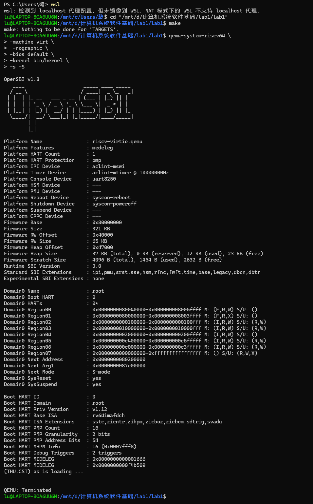
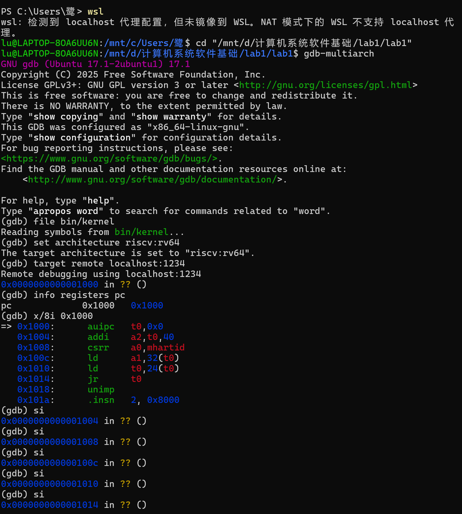
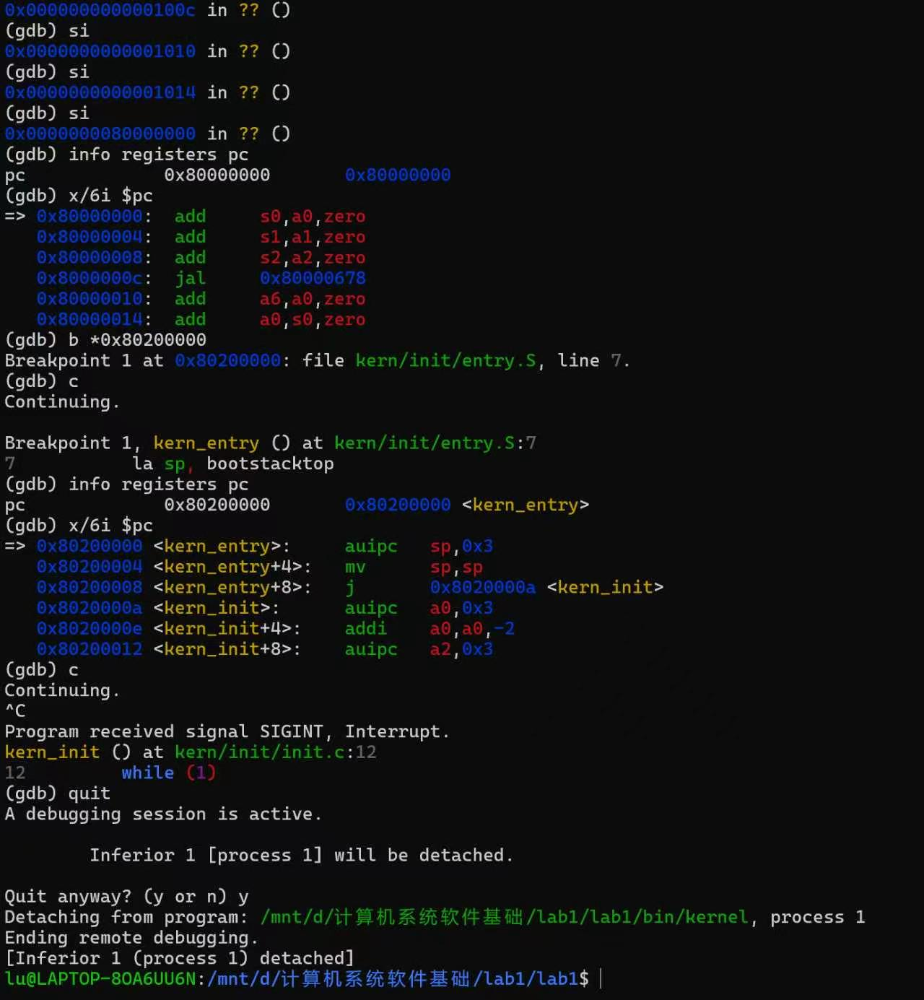

# 实验报告

## 实验基本信息

| 项目 | 内容 |
|------|------|
| **实验名称** | Lab 1: 最小可执行内核 |
| **小组成员** | 2510720-董隽仪、2512607-董语晗、2513328-何妍希 |
| **完成日期** | 2026-10-11 |

### 小组分工

练习如何分工？

| 成员 | 负责的练习/模块 |
|------|----------------|
| 2510720-董隽仪 | 环境搭建、参与实验报告撰写、环境搭建 |
| 2512607-董语晗 | 实验报告撰写与整理、代码调试与运行、环境搭建 |
| 2513328-何妍希 | 代码调试与运行、环境搭建、参与实验报告撰写 |

实验报告如何分工？

---

## 一、实验目的

<!-- 说明本次实验的主要目标和预期成果 -->

本实验的目标是理解一个最小操作系统内核如何开始运行，并使用 QEMU 和 GDB 验证启动过程。主要学习交叉编译、链接脚本、内核栈、固件与内核的交接，以及内核的基础输出功能。

---

## 二、实验环境

你们使用的 AI 工具

| 成员 | AI 编程工具 | 底层模型 | 备注 |
|------|------------|---------|------|
| 2510720-董隽仪 | Chat GPT | GPT-5.6 |  |
| 2512607-董语晗 | Chat GPT | GPT-6.1 | |
| 2513328-何妍希 | Chat GPT | GPT-6.1 | |

**说明：**

- **AI 编程工具**：指具体使用的终端工具、编辑器插件、桌面应用或浏览器界面
- **底层模型**：指该工具使用的大语言模型及版本

---

## 三、实验整体逻辑分析

### 3.1 本章节的逻辑主线

我将 Lab1 理解为三个相互衔接的过程：首先生成内核程序，然后让模拟计算机启动并进入内核，最后由内核完成最基础的初始化和输出。

#### 1. 生成内核程序

执行 `make` 后，编译器和汇编器将 C 文件及汇编文件转换成目标文件，链接器按照 `tools/kernel.ld` 将它们组合为 `bin/kernel`。Makefile 还通过 `objcopy` 生成原始二进制镜像 `bin/ucore.img`。

这里使用交叉编译，是因为编译工具运行在电脑的 Ubuntu 环境中，而生成的程序要在 QEMU 模拟的 RISC-V CPU 上执行。

链接脚本将内核的基地址设为 `0x80200000`，并指定入口符号为 `kern_entry`。链接脚本负责安排代码和数据的地址；QEMU 的加载过程则负责将程序实际放入模拟机器的内存。这是两个不同的步骤。

#### 2. 从复位代码进入内核

本实验中观察到的执行流程为：

```text
CPU 复位，PC = 0x1000
        ↓
执行复位代码，准备参数并跳转
        ↓
执行 OpenSBI（0x80000000 附近）
        ↓
OpenSBI 初始化启动环境，将控制权交给内核
        ↓
执行 kern_entry（0x80200000）
        ↓
设置内核栈，跳转到 kern_init
```

`PC` 是程序计数器，用来指示接下来要执行的指令位置。查看 PC，就可以知道 CPU 的执行流程到达了哪里。

需要区分“加载内核”和“执行内核”：在本次使用的 QEMU 启动方式中，固件和内核由 QEMU 在 CPU 开始执行前加载到内存；OpenSBI 随后完成启动准备，并跳转到内核入口。因此不能将这次启动描述为 OpenSBI 从硬盘读取并加载内核。

#### 3. 内核的最基础工作

根据 `kern/init/init.c`，`kern_init()` 依次完成以下工作：清零 `.bss` 所在区域，调用 `cprintf` 输出启动信息，然后进入无限循环。

Lab1 的内核还没有实现进程调度、完整的内存管理和文件系统。它的作用是建立一个可以继续扩展的最小内核起点。

### 3.2 功能的逐步实现

| 文件或模块                             | 核心作用                                 |
| -------------------------------------- | ---------------------------------------- |
| `Makefile`                             | 组织编译、链接、镜像生成和 QEMU 启动命令 |
| `tools/kernel.ld`                      | 指定内核架构、入口及代码和数据的内存布局 |
| `kern/init/entry.S`                    | 设置启动栈指针，转入 C 语言初始化函数    |
| `kern/init/init.c`                     | 清零数据区域，输出启动信息，进入循环     |
| `kern/libs/stdio.c`、`libs/printfmt.c` | 实现内核自己的格式化输出                 |
| `kern/driver/console.c`                | 提供控制台字符输出接口                   |
| `libs/sbi.c`                           | 通过 `ecall` 请求 OpenSBI 服务           |

#### 1. 链接脚本与内存布局

`OUTPUT_ARCH(riscv)` 指定目标架构，`ENTRY(kern_entry)` 指定可执行文件的入口，`BASE_ADDRESS = 0x80200000` 用来安排内核的起始地址。

主要的数据组织方式如下：

| 段               | 保存的内容                           |
| ---------------- | ------------------------------------ |
| `.text`          | 汇编代码，即可执行指令               |
| `.rodata`        | 只读数据，通常是常量，如字符串常量   |
| `.data` `.sdata` | 已初始化的可读写数据，通常是全局变量 |
| `.bss`           | 被初始化为 00 的可读写数据           |

脚本中的 `ALIGN(0x1000)` 表示按 4096 字节边界对齐。`edata` 和 `end` 是链接脚本提供的地址符号，用于确定启动时需要清零的区域。

#### 2. `kern_init()`

```c
extern char edata[], end[];
memset(edata, 0, end - edata);
```

这段代码从 `edata` 开始，将长度为 `end - edata` 的内存区域清零，使 `.bss` 中的数据具有应有的初始零值。

```c
const char *message = "(THU.CST) os is loading ...\n";
cprintf("%s\n\n", message);
```

这段代码输出内核启动信息。若终端显示这句话，说明执行流程已经进入 C 内核代码，并且输出功能可以工作。

```c
while (1)
    ;
```

内核在打印后进入无限循环。由于 Lab1 暂时没有安排后续任务，这种持续停留是代码的预期行为。`noreturn` 属性也表明 `kern_init()` 不会正常返回。

#### 3. `cprintf` 与 SBI 输出

内核不能直接依赖普通应用程序使用的现成操作系统运行环境，因此实验提供了自己的格式化输出实现。

其主要调用关系为：

```text
cprintf
  → vcprintf
  → vprintfmt（处理 %s、%d 等格式）
  → cputch（逐个输出字符）
  → cons_putc
  → sbi_console_putchar
  → sbi_call
  → ecall，请求 OpenSBI 输出字符
```

`sbi_call()` 将服务编号放入 `a7`，将参数放入 `a0`、`a1`、`a2`，执行 `ecall` 后，从 `a0` 取回返回值。实验中的字符输出使用传统 SBI 控制台服务，服务编号为 1。

本实验的内核运行在 S 模式，OpenSBI 运行在权限更高的 M 模式。这里的 `ecall` 是内核请求固件服务的方式，与应用程序请求内核服务的系统调用有相似之处，但调用双方不同。

## 四、实验内容与实现

<!-- 
说明：本部分按照 exercises 文档中的练习顺序组织
每个功能模块或者练习中可能包含多项任务，请根据实际情况调整
-->

### 练习 1：理解内核入口操作

入口代码为：

```asm
kern_entry:
    la sp, bootstacktop
    tail kern_init
```

#### 1. `la sp, bootstacktop` 完成的操作和目的

**完成的操作：**将 `bootstacktop` 的地址加载到栈指针寄存器 `sp` 中。

启动栈的定义为：

```asm
bootstack:
    .space KSTACKSIZE
bootstacktop:
```

`.space KSTACKSIZE` 在内核数据区预留连续的栈空间，`bootstack` 标记起始位置，`bootstacktop` 标记末端位置。

由于栈向低地址增长，启动时应让 `sp` 指向高地址一端的 `bootstacktop`。后续函数使用栈时，再向低地址方向分配空间。

**目的：**为后续 C 函数执行准备可用的栈，使函数能够保存局部变量、部分寄存器和返回地址等信息。若不先设置正确的 `sp`，使用栈时可能访问错误地址，内核就无法可靠运行。

#### 2. `tail kern_init` 完成的操作和目的

**完成的操作：**跳转到 `kern_init`，不为这次跳转保存返回地址。

`tail` 是汇编伪指令，具体生成的指令由汇编和链接过程决定。本次反汇编中显示为 `j`，说明执行流程直接转入 `kern_init`。

**目的：**在栈准备完成后，将控制权从汇编入口交给 C 语言实现的内核初始化函数。由于 `kern_init` 不会返回，启动流程不需要再回到 `kern_entry`，因此使用尾跳转。

### 练习 2：使用 GDB 验证启动流程

#### 1. 调试方法

本次调试使用两个 Ubuntu 终端：第一个终端运行 QEMU，第二个终端运行 GDB。首先进入实验目录并编译内核：

```bash
cd "/mnt/d/计算机系统软件基础/lab1/lab1"
make
```

随后启动 QEMU：

```bash
qemu-system-riscv64 \
  -machine virt \
  -nographic \
  -bios default \
  -kernel bin/kernel \
  -s -S
```

其中，`-kernel bin/kernel` 指定要运行的内核；`-S` 使模拟 CPU 在执行第一条指令前暂停；`-s` 在 1234 端口开启 GDB 调试服务。

在第二个终端启动 GDB，并连接 QEMU：

```bash
cd "/mnt/d/计算机系统软件基础/lab1/lab1"
gdb-multiarch
```

```gdb
file bin/kernel
set architecture riscv:rv64
target remote localhost:1234
```

`file bin/kernel` 让 GDB 读取内核的符号和调试信息；`target remote` 让 GDB 连接 QEMU 中暂停的模拟 CPU。

#### 2. 观察复位地址及最初的指令

连接成功后，使用下面的命令查看程序计数器 PC：

```gdb
info registers pc
```

实际结果为：

```text
pc             0x1000   0x1000
```

这说明 RISC-V CPU 加电复位后，准备从地址 `0x1000` 开始执行。继续查看该地址附近的指令：

```gdb
x/8i 0x1000
```

实际结果为：

```text
=> 0x1000:      auipc   t0,0x0
   0x1004:      addi    a2,t0,40
   0x1008:      csrr    a0,mhartid
   0x100c:      ld      a1,32(t0)
   0x1010:      ld      t0,24(t0)
   0x1014:      jr      t0
   0x1018:      unimp
   0x101a:      .insn   2, 0x8000
```

*此处插入截图 1：初始 PC 为 `0x1000` 及复位地址处的反汇编结果。*

前六条指令是实际执行的复位代码，主要作用如下：

| 指令              | 主要作用                                |
| ----------------- | --------------------------------------- |
| `auipc t0,0x0`    | 得到当前复位代码所在的基准地址 `0x1000` |
| `addi a2,t0,40`   | 准备传给下一启动阶段的信息地址          |
| `csrr a0,mhartid` | 读取当前硬件线程（hart）的编号          |
| `ld a1,32(t0)`    | 读取设备树地址等启动参数                |
| `ld t0,24(t0)`    | 读取 OpenSBI 的入口地址                 |
| `jr t0`           | 跳转到 OpenSBI，进入下一启动阶段        |

`0x1018` 后面的内容主要是启动数据。因为 `x/8i` 要求 GDB 连续显示八条“指令”，GDB 把数据也按指令解释，才显示了 `unimp` 等内容。CPU 在 `0x1014` 已经通过 `jr t0` 跳走，并不会接着执行这些数据。

#### 3. 单步进入 OpenSBI

在 GDB 中连续执行六次单步命令：

```gdb
si
```

再次查看 PC 后，观察到 CPU 已从 `0x1000` 附近的复位代码跳到 `0x80000000` 附近，即进入 OpenSBI 所在的区域：

```gdb
info registers pc
x/6i $pc
```

*此处插入截图 2：单步执行后，PC 进入 `0x80000000` 附近的 OpenSBI。*

这一步说明最初的复位代码本身只负责准备少量启动参数并完成跳转，后续较完整的启动初始化工作由 OpenSBI 完成。

#### 4. 在内核入口设置断点

为了避免逐条跟踪 OpenSBI 中的大量指令，在内核入口地址设置断点，然后继续执行：

```gdb
b *0x80200000
c
```

实际结果为：

```text
Breakpoint 1 at 0x80200000: file kern/init/entry.S, line 7.
Continuing.

Breakpoint 1, kern_entry () at kern/init/entry.S:7
7           la sp, bootstacktop
```

检查 PC 和当前位置的机器指令：

```gdb
info registers pc
x/6i $pc
```

实际结果包括：

```text
pc             0x80200000       0x80200000 <kern_entry>

0x80200000 <kern_entry>:     auipc   sp,0x3
0x80200004 <kern_entry+4>:   mv      sp,sp
0x80200008 <kern_entry+8>:   j       0x8020000a <kern_init>
```

*此处插入截图 3：GDB 命中 `0x80200000` 断点，PC 指向 `kern_entry`。*

这证明 OpenSBI 已经完成启动准备，并将 CPU 的控制权交给了内核。源代码中的伪指令 `la sp, bootstacktop` 被转换成前两条真实机器指令，用于设置栈指针；第三条指令跳转到 `kern_init`。

#### 5. 观察 OpenSBI 启动信息

在 QEMU 终端中观察到 OpenSBI 的启动信息，其中包括：

```text
OpenSBI v1.8
Domain0 Next Address        : 0x0000000080200000
Domain0 Next Mode           : S-mode
```

*此处插入截图 4：OpenSBI 版本、`Domain0 Next Address` 和 `Domain0 Next Mode`。*

`Domain0 Next Address` 为 `0x80200000`，表示 OpenSBI 完成初始化后要跳转到该地址；`Next Mode` 为 `S-mode`，表示内核从 S 特权级开始运行。这与 GDB 在 `0x80200000` 命中断点的结果相互验证。

#### 6. 继续执行内核

在 GDB 中再次输入：

```gdb
c
```

QEMU 终端中出现：

```text
(THU.CST) os is loading ...
```

*此处插入截图 5：内核输出 `(THU.CST) os is loading ...`。*

这说明 `kern_entry` 已经设置好内核栈并跳转到 `kern_init()`，同时内核的 `cprintf()` 输出功能可以正常工作。输出后程序不再出现新内容，是因为 `kern_init()` 最后执行了无限循环 `while (1);`，属于预期结果。

#### 7. 问题回答

**RISC-V 硬件加电后最初执行的几条指令位于什么地址？**

在本实验使用的 QEMU `virt` 机器中，CPU 加电复位后 PC 为 `0x1000`，最初执行的六条指令位于 `0x1000` 至 `0x1014`。`0x1000` 是这台模拟机器使用的复位地址。

**这些指令主要完成了哪些功能？**

这些指令计算启动信息的位置，读取当前 hart 编号、设备树地址和 OpenSBI 入口地址，最后通过 `jr t0` 跳转到 OpenSBI。OpenSBI 随后完成启动环境初始化，并跳转到 `0x80200000`，开始执行内核的 `kern_entry`。

本次调试完整观察到以下启动路径：

```text
0x1000 复位代码
    → 0x80000000 附近的 OpenSBI
    → 0x80200000 的 kern_entry
    → kern_init
    → 输出 os is loading ...
```

题目提示可以使用 `watch *0x80200000` 观察内核加载，但本次启动时 QEMU 在 CPU 开始执行之前已经将内核放入内存。GDB 连接发生在此后，所以没有使用观察点作为验证依据，而是通过 `b *0x80200000` 验证 OpenSBI 向内核的控制权移交。

---

## 五、测试与验证

<!-- 根据该实验的具体情况，提供完整的测试运行截图，应包含：
- 编译及运行成功的输出（make qemu），可能有多个
- 测试通过的结果（make grade），只有一个
-->

**测试截图：**




---

## 六、实验总结与收获

### 对操作系统的理解

1. 列出你们认为本实验中重要的知识点，以及与对应的 OS 原理中的知识点，并简要说明二者的含义、关系和差异

   | 实验知识点                  | 对应原理               | 二者关系及本实验的范围                                       |
   | --------------------------- | ---------------------- | ------------------------------------------------------------ |
   | 复位代码、OpenSBI、内核入口 | 操作系统启动           | 展示从早期固件到内核的控制权移交；本实验由 QEMU 预加载镜像，没有实现从真实磁盘读取系统的完整流程 |
   | 内核启动栈及 `sp`           | 函数调用、运行时栈     | 为 C 函数执行提供保存临时数据的空间；这里只有启动栈，没有实现进程各自的栈和切换 |
   | 交叉编译和链接脚本          | 程序构建与内存布局     | 将源码转换为目标机器指令，并安排代码、数据地址；链接时的地址安排不等于运行时的内存分配 |
   | `.bss` 清零                 | 程序初始化             | 保证相关全局、静态数据初始为零；尚不涉及完整的虚拟内存管理   |
   | SBI 调用和 `ecall`          | 特权级与受控服务请求   | 本实验是 S 模式内核请求 M 模式固件服务；应用程序请求内核服务通常是 U 模式到 S 模式，调用双方不同 |
   | `cprintf` 与控制台输出      | 输入输出抽象、模块分层 | 将格式处理和字符输出分开；本实验主要依赖固件提供字符服务，没有实现完整驱动管理体系 |
   | GDB 断点及寄存器查看        | 运行状态与调试         | 用实际 PC 和指令验证执行流程；调试工具帮助观察内核，本身不是内核功能 |

2. 列出你们认为 OS 原理中很重要、但在本实验中没有对应上的知识点

   1. **进程、线程与调度。** 操作系统需要管理多个任务并分配 CPU 时间。本实验只有启动流程和无限循环，没有多任务调度。
   2. **虚拟内存与页表。** 操作系统需要完成地址转换、隔离和内存分配。本实验安排了内核布局和启动栈，但没有完整实现这些机制。
   3. **异常、中断与时钟处理。** 操作系统需要响应硬件事件并处理运行错误。Lab1 尚未建立完整的内核异常和中断处理流程；SBI 输出会使用 `ecall`，因此也不是完全没有接触异常机制。
   4. **文件系统。** 操作系统需要以文件和目录管理持久数据。本实验没有实现文件存储与访问功能。
   5. **同步与互斥。** 多任务共享资源时需要避免冲突。本实验还没有并发任务，也没有实现相关同步机制。
   6. **用户程序与系统调用。** 完整操作系统需要运行用户程序并提供服务接口。本实验尚未运行用户程序，使用的 SBI 调用是内核与固件之间的服务请求。

### AI 协作开发的经验

这次实验中，我们主要用AI帮助理解代码和排查报错。遇到QEMU不能跳转到内核入口时，我们把终端输出发给AI，再根据建议修改启动命令并重新验证。这个过程让我们认识到，AI可以帮助分析问题、解释概念，但给出的结论不能直接照搬，还需要结合代码和实际运行结果判断。
